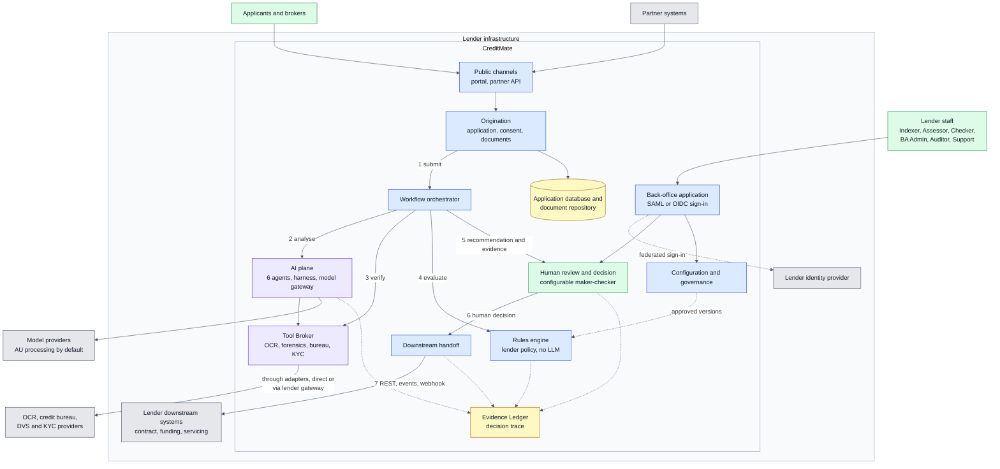
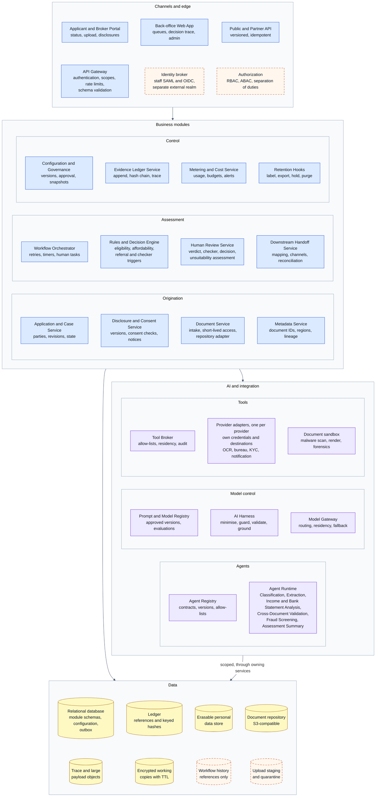
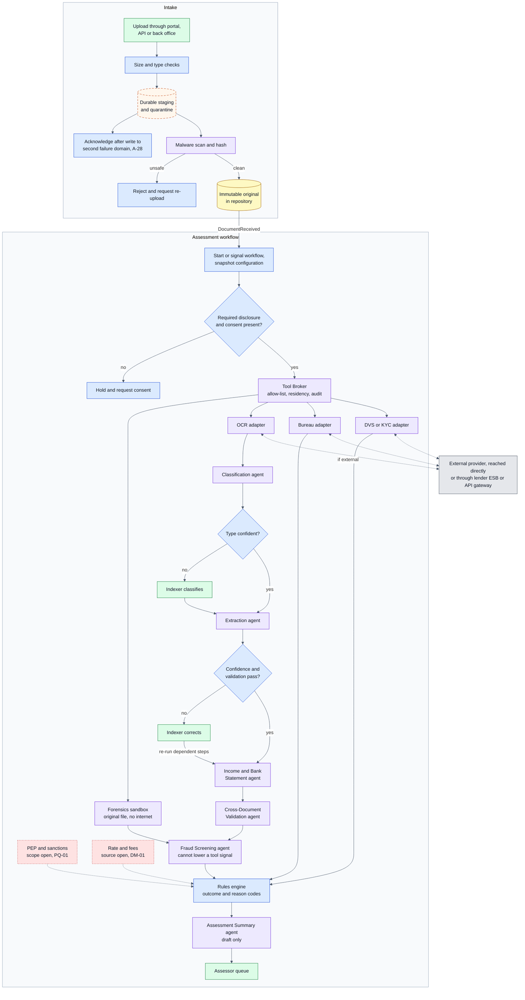
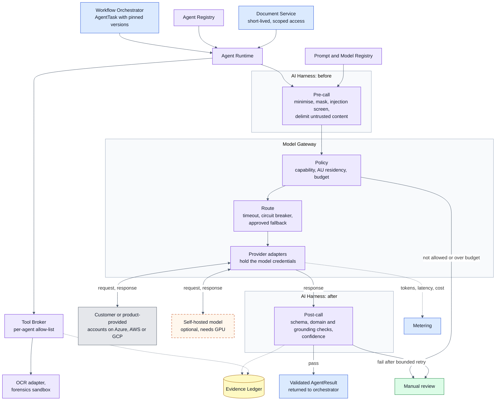
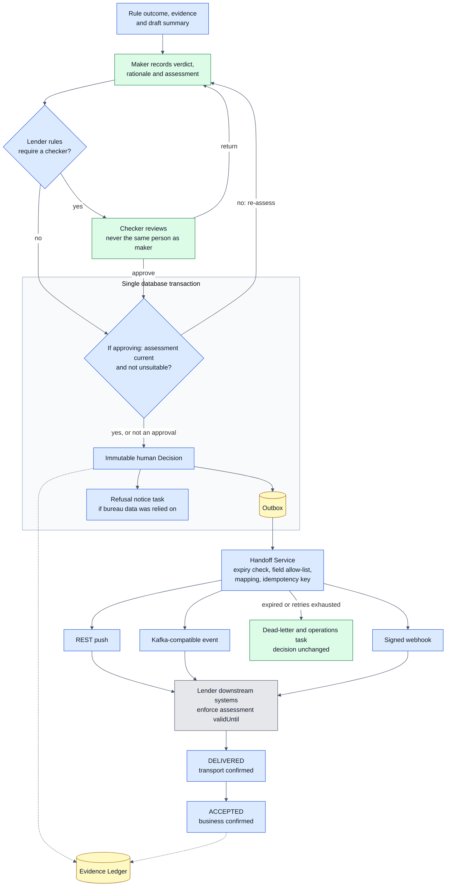
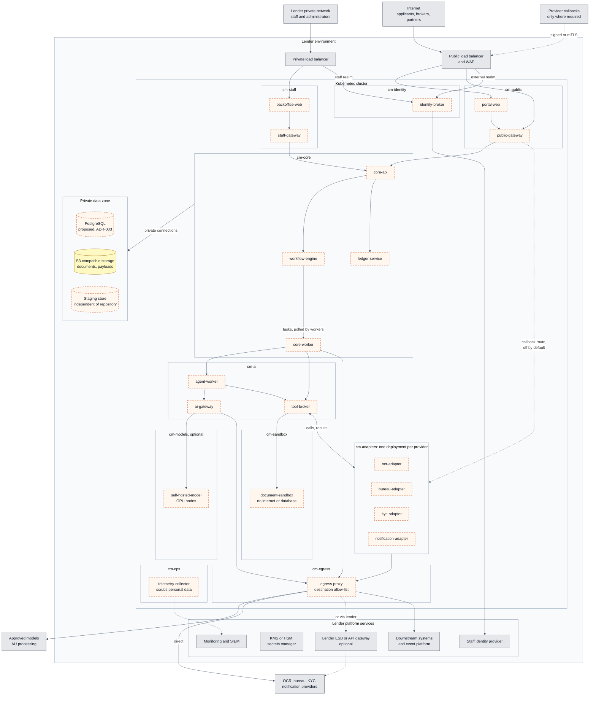
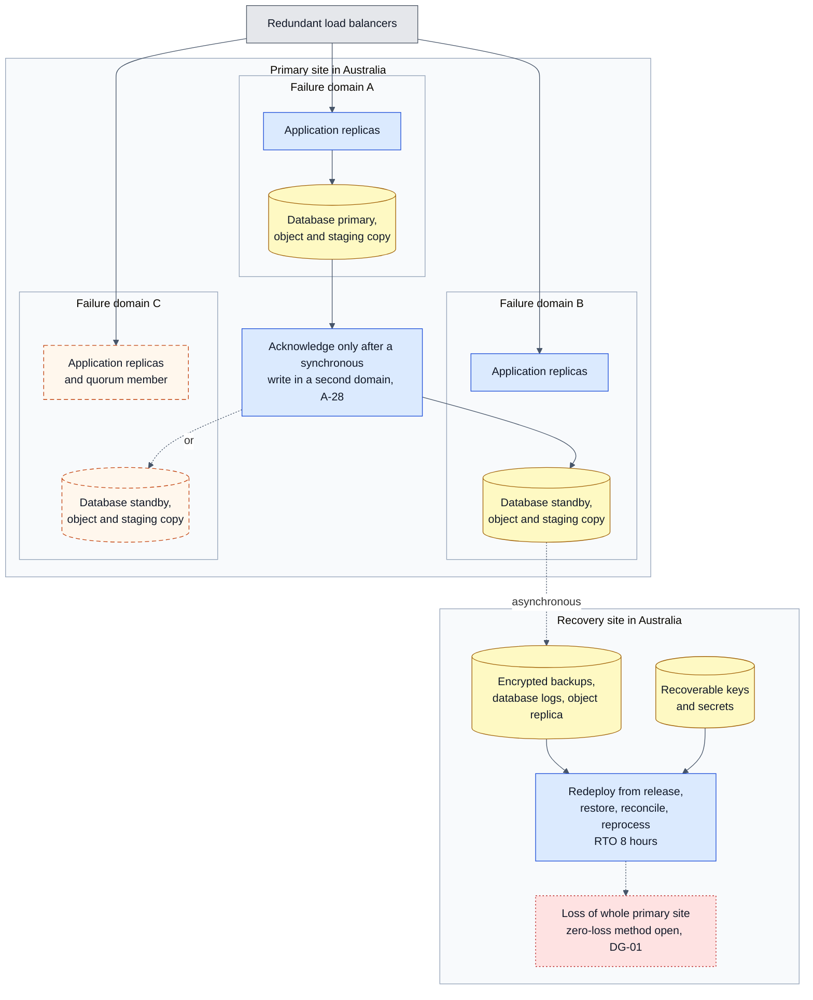
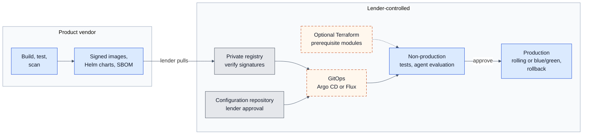

# CreditMate - Architecture Diagrams v0.2

> Status: DRAFT, 2026-11-22. For architects, engineers, and lender infrastructure and security teams.
> Based on `ARCHITECTURE_DRAFT.md` v0.4, `DOMAIN_MODEL.md` v0.2 and the decisions (D-xx) and assumptions (A-xx) in `PROJECT_BRIEF.md`.
> v0.2 corrects the external integration route: Tool Broker, provider adapters, callbacks and lender gateways (DG-09..DG-11).
> The Mermaid source in this file is the master. The images in `diagrams/` are exports of it.

| Level | Question it answers | Diagrams |
|---|---|---|
| 1. High-level | What is the product, who uses it and what does it connect to? | [HLD](#1-high-level-architecture) |
| 2. Low-level | What are the components and how do they work together? | [2A components](#2a-component-map), [2B intake and processing](#2b-intake-and-processing), [2C AI call path](#2c-ai-call-path), [2D decision and handoff](#2d-decision-and-handoff) |
| 3. Deployment | What runs where in the lender's infrastructure? | [3A topology](#3a-deployment-topology), [3B availability and recovery](#3b-availability-and-recovery), [3C release path](#3c-release-path) |

How to read all diagrams:

| Style | Meaning |
|---|---|
| Solid border | In the draft design |
| Dashed orange border | Proposed technology, placement or control. Not yet approved |
| Dotted red border | Open question. Not designed |
| Blue | Product component |
| Purple | AI plane |
| Green | Human action or user |
| Yellow | Data store |
| Grey | Outside the product |

---

## 1. High-level architecture

AI produces evidence and recommendations, rules apply lender policy, and a human decides. The whole product runs in one lender's infrastructure.

[Open as image](diagrams/1-high-level.png)

<!-- diagram: 1-high-level -->

Lender infrastructure is on-premises or any cloud, with one installation per lender. Dotted arrows are sign-in, configuration and audit writes.

---

## 2. Low-level architecture

### 2A. Component map

All modules, their main parts and their stores. Arrows between layers show allowed dependencies. 2B to 2D show the detailed calls.

[Open as image](diagrams/2a-components.png)

<!-- diagram: 2a-components -->

Component rules:

- A module writes only its own data and refers to other modules' data by ID.
- Agents never call each other, hold provider or repository credentials, or write business data.
- Only the Model Gateway calls models. Tools are called only through the Tool Broker.
- Only the Tool Broker calls provider adapters. An adapter holds the credentials for its own provider and no other.
- `tenantId` travels in every call, event, row and trace (D-36).

### 2B. Intake and processing

[Open as image](diagrams/2b-intake-processing.png)

<!-- diagram: 2b-intake-processing -->

- Every tool request and result passes through the Tool Broker, including calls made by agents. Arrows out of the tools show where results are used.
- Dotted two-way arrows are external calls through the proposed egress proxy (DG-05).
- KYC can be a manual check where lender policy says so (D-26).
- Submission starts the workflow. A new document signals the running one. Bureau and KYC run once per party, not per document.
- Joint and self-employed cases go to manual assessment without an AI recommendation (A-25).
- A failed fraud check is `NOT_ASSESSABLE` and refers the case. It is never treated as clean.
- Any step that exhausts its retries goes to manual review.

### 2C. AI call path

[Open as image](diagrams/2c-ai-call-path.png)

<!-- diagram: 2c-ai-call-path -->

### 2D. Decision and handoff

[Open as image](diagrams/2d-decision-handoff.png)

<!-- diagram: 2d-decision-handoff -->

A change to data, documents or verdict after submission invalidates the checker's approval (D-42).

---

## 3. Deployment architecture

The target is generic Kubernetes or OpenShift with S3-compatible storage (D-30, D-35). **The namespaces, deployable grouping and replica counts are proposals.**

### 3A. Deployment topology

[Open as image](diagrams/3a-deployment.png)

<!-- diagram: 3a-deployment -->

The environment can be on-premises, AWS, Azure, GCP or another platform. Network policies deny by default. The data zone can be in the cluster or lender-managed. Only the main connections are drawn: key, telemetry and other secondary connections are in the table below.

#### What each deployable contains

A-16 calls for a few deployables with enforced module boundaries, rather than one service per module.

| Deployable | Contains | Scales on | Proposed minimum replicas |
|---|---|---|---|
| portal-web | Applicant and Broker Portal | Requests | 2 |
| backoffice-web | Back-office Web App | Requests | 2 |
| public-gateway | API Gateway for portal and partner API | Requests | 2 |
| staff-gateway | API Gateway for staff | Requests | 2 |
| identity-broker | Staff federation, external realm | Sign-ins | 2 |
| core-api | Application and Case, Disclosure and Consent, Document, Metadata, Human Review, Configuration and Governance, Agent Registry, Prompt and Model Registry, Metering, Retention Hooks API, authorization | Requests | 3 |
| core-worker | Workflow activities, Rules engine, outbox relay, Handoff, purge and export jobs | Queue depth | 3 |
| workflow-engine | Workflow Orchestrator (ADR-004) | Workflow rate | 3 |
| ledger-service | Evidence Ledger, with its own database role | Writes | 2 |
| agent-worker | Agent Runtime and the six agents | Queue depth, provider quota | 3 |
| ai-gateway | AI Harness, Model Gateway | Calls in flight | 3 |
| tool-broker | Tool Broker. Holds no provider credentials | Calls in flight | 2 |
| ocr-adapter | Adapter for one OCR provider or engine | Calls in flight | 2 |
| bureau-adapter | Adapter for one credit bureau | Calls in flight | 2 |
| kyc-adapter | Adapter for one DVS or KYC provider. Omitted if checks are manual | Calls in flight | 2 |
| notification-adapter | Adapter for one notification provider | Calls in flight | 2 |
| document-sandbox | Malware scan, rendering, forensics | Queue depth | 2 |
| self-hosted-model | Optional local model serving | GPU capacity | 2 if used |
| egress-proxy | Outbound allow-list | Connections | 2 |
| telemetry-collector | OpenTelemetry collection and scrubbing | Volume | 2 |

The four adapters share one chart template. Deploy one instance per provider in use, including any later third-party fraud provider (D-18). They are extensions (draft section 20), not new core services.

Replica counts provide redundancy only. They are not sizing, which needs the 5x load test (A-33).

#### Allowed connections

Anything not listed is denied, apart from cluster DNS.

| From | To | Proposed protocol | Purpose |
|---|---|---|---|
| Public load balancer | portal-web, public-gateway, identity-broker (external realm) | HTTPS | External traffic and sign-in |
| Private load balancer | backoffice-web, staff-gateway, identity-broker (staff realm) | HTTPS | Staff traffic and sign-in |
| portal-web | public-gateway | HTTPS | Portal API |
| backoffice-web | staff-gateway | HTTPS | Staff API |
| public-gateway, staff-gateway | core-api, identity-broker | HTTPS with mTLS | APIs and token keys |
| identity-broker | Staff identity provider | SAML 2.0 or OIDC over HTTPS | Federation |
| identity-broker, workflow-engine | Their own databases | PostgreSQL with TLS | State |
| core-api | workflow-engine, ledger-service | gRPC or HTTPS with mTLS | Business operations |
| core-api, core-worker | PostgreSQL | PostgreSQL with TLS | Module schemas, outbox |
| core-api, core-worker | Object and staging stores | S3 API over HTTPS | Documents, export, purge |
| core-worker | workflow-engine, core-api, ledger-service, agent-worker, tool-broker | gRPC or HTTPS with mTLS | Workflow steps. Workers poll the engine |
| core-worker | egress-proxy | HTTPS, Kafka protocol with TLS | Handoff |
| ledger-service | PostgreSQL, object store | PostgreSQL with TLS, S3 API | Ledger and anchors |
| agent-worker | ai-gateway, tool-broker, core-api, ledger-service | gRPC or HTTPS with mTLS | Agent tasks |
| ai-gateway | core-api, ledger-service, self-hosted-model | gRPC or HTTPS with mTLS | Registries, metering, local models |
| ai-gateway | egress-proxy | HTTPS | Models |
| tool-broker | ocr-adapter, bureau-adapter, kyc-adapter, notification-adapter | gRPC or HTTPS with mTLS | Provider calls |
| ocr-adapter, bureau-adapter, kyc-adapter, notification-adapter | egress-proxy | HTTPS, or the protocol the provider requires, with encryption | Each adapter reaches only its own destination |
| Public load balancer | public-gateway, separate callback route | HTTPS, signed or mTLS | Provider callbacks, off by default |
| Private load balancer | staff-gateway, separate callback route | HTTPS, signed or mTLS | Callbacks relayed by a lender gateway, off by default |
| public-gateway, staff-gateway | Adapters with callbacks enabled | HTTPS with mTLS | Callback delivery |
| Adapters with callbacks enabled | tool-broker | gRPC or HTTPS with mTLS | Verified callback results |
| tool-broker | document-sandbox, core-api, ledger-service | gRPC or HTTPS with mTLS | Tools |
| document-sandbox | core-api | HTTPS with mTLS | Scoped document access and results only |
| egress-proxy | Approved providers, lender ESB or API gateway, downstream systems | HTTPS, Kafka protocol with TLS, approved provider protocols | Outbound traffic |
| Workloads that need keys or secrets | KMS, secrets manager | HTTPS | Workload identity |
| All workloads | telemetry-collector | OTLP with TLS | Telemetry |
| telemetry-collector | Lender monitoring and SIEM | OTLP or lender's protocol | Export |

#### External integration rules

- **Route:** workflow or agent, Tool Broker, provider adapter, egress proxy, then the provider or the lender's gateway. The API Gateway is not on the outbound path.
- **Results:** a synchronous response or polling is the default. Callbacks are enabled for a provider only where it requires them.
- **Callbacks:** the adapter verifies the sender and rejects replays. The Tool Broker matches the result to an outstanding request through core-api, which saves it and signals the workflow. The provider is acknowledged only after the save. A missing callback is reconciled, not treated as a clean result.
- **Retries:** no layer automatically resends a bureau enquiry unless A-30 is met. This covers the workflow engine, adapter, service mesh, egress proxy and lender gateway.
- **Lender gateway:** it does not replace the Tool Broker. The lender confirms the final provider, processing region and payload logging, because CreditMate cannot observe them.

Vendor support has no standing path. Access is time-limited, lender-approved break-glass (A-08).

### 3B. Availability and recovery

[Open as image](diagrams/3b-availability-recovery.png)

<!-- diagram: 3b-availability-recovery -->

All replicas write to the database primary. Only an up-to-date standby may be promoted. The lender provides the recovery site (A-11).

Failure domains are zones in a cloud, or separately powered rooms or racks on-premises.

### 3C. Release path

[Open as image](diagrams/3c-release.png)

<!-- diagram: 3c-release -->

The vendor does not push into lender environments.

### What changes by target

| Capability | On-premises | AWS | Azure | GCP | Portability |
|---|---|---|---|---|---|
| Kubernetes | Kubernetes or OpenShift | EKS | AKS | GKE | High, with differences in ingress and security policy |
| Database | Self-operated PostgreSQL | RDS or self-operated | Flexible Server or self-operated | Cloud SQL or self-operated | Medium. Failover and replication differ |
| Object storage | Supported S3-compatible store | S3 | Blob has no native S3 API: needs an adapter or separate store | Cloud Storage has partial S3 interoperability: test it | Low to high, by target |
| Keys | HSM or Vault | KMS | Key Vault | Cloud KMS | Medium |
| Edge | Lender WAF and load balancer | AWS WAF, load balancer | Application Gateway WAF | Cloud Armor | Low |
| Models | Approved AU egress, or self-hosted with GPU | Bedrock | Azure OpenAI | Vertex AI | Medium. AU processing is checked per model |

Managed service names are examples and have not been validated for this product.

---

## 4. Design gaps found while drawing

These are not decided. They need an answer or an ADR.

| ID | Gap | Recommendation | Affects |
|---|---|---|---|
| DG-01 | "No document loss" (D-11) and A-28 cover a second failure domain, but do not say whether losing a whole site or region is included | Promise zero loss for a single failure domain. Offer cross-site zero loss only where the lender funds synchronous replication | 3B, contract, infrastructure minimum |
| DG-02 | A durable workflow engine keeps payload history and may apply its own retention period, which conflicts with A-27 and D-39 | Put references only in history, make its retention customer-set and include it in purge | 2A, ADR-004 |
| DG-03 | The draft scans before storing, but also needs a durable acknowledgement and must accept uploads during a repository outage | Add a replicated, quarantined staging store that is independent of the repository | 2B, 3A, ADR-015 |
| DG-04 | Two failure domains cannot keep quorum and accept synchronous writes through every single-domain failure | Make three failure domains the recommended production minimum. Document a reduced guarantee for two | 3B, A-11 |
| DG-05 | Standard Kubernetes NetworkPolicy cannot allow-list by host name | Route all outbound traffic through an egress proxy, either bundled or the lender's | 3A, security design |
| DG-06 | The default S3-compatible store (D-30) is not native on Azure | Decide between a Blob adapter in Phase 1 and a lender-supplied S3-compatible store | 3A, OP-04 |
| DG-07 | Public and staff traffic share one gateway in the draft's section 3 | Use separate public and private gateways from the same component | 3A, security design |
| DG-08 | The draft names no product for the applicant and broker realm | Select it with ADR-021, with a separate realm and preferably a separate instance | 3A, ADR-021 |
| DG-09 | v0.1 put all adapters in the Tool Broker. Draft section 20 packages them separately or in an adapter host, while section 5 has the broker inject secrets | Deploy one adapter per provider, holding only its own credentials. Shown in v0.2. Confirm against A-16 by ADR and align draft section 5 | 2A, 3A, draft sections 5 and 20 |
| DG-10 | The draft has no inbound path for asynchronous provider results | Poll by default, with a verified callback route only where required. Shown in v0.2. Confirm by ADR | 3A, security design |
| DG-11 | A lender may require provider calls to use its ESB or API gateway, which hides retries, final destination and logging | Support it as an adapter destination behind the Tool Broker, with lender confirmation of all three. Shown in v0.2 | 1, 2B, 3A, A-30, D-31 |
