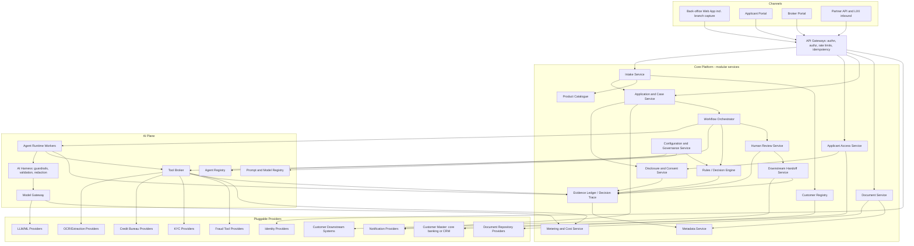

# CredAIble - Architecture Draft v0.5

> Status: DRAFT, refreshed 2026-11-27. Built on `PROJECT_BRIEF.md` (decisions D-01..D-66, assumptions A-01..A-44, open questions OQ-xx).
> v0.5 adds origination channels, applicant access, the Customer Registry, product definitions and internet trust zones (section 27).
> All assumptions were accepted, amended or superseded on 2026-11-22 (D-44); see section 25.
> Review findings (RF-xx) and the questions arising from the review are in section 26.
> Technology names are **proposals** pending ADR approval (section 22). The technology stack and engineering conventions are in `TECHNICAL_DESIGN.md`. Nothing here is legal advice.

---

## 1. Architecture drivers

| Driver | Source | Implication |
|---|---|---|
| AI recommends, human decides, reasons recorded | D-06, D-08, D-15 | Decision Trace and Evidence Ledger are core; no auto-decision path exists |
| AU non-bank lenders now, banks later | D-01, D-07, D-43 | AU residency, responsible-lending evidence, credit-bureau integration |
| Complete LOS for personal loans | D-03, D-04, D-22, D-34 | Intake through recorded human decision, then handoff to customer systems (D-37) |
| Faster, cheaper, more auditable | D-02 | Reviewer time per application is the main value metric (A-21) |
| Back-office personas | D-09, D-25 | Indexers work AI exceptions; Assessors decide; BA Admins own policy |
| ~1,000 apps/day, ~8,000 docs/day | D-10 | Per-lender design target (D-36); modular, horizontally scalable (A-16); LLM latency is the main technical constraint; review labour dominates cost (section 19) |
| RTO 8h; no document loss; reprocess | D-11 | Durable storage, idempotent workflows, replay of unfinished work |
| Single-tenant, on-premises or any cloud | D-12, D-13, D-35 | Helm-packaged product; no vendor-operated SaaS control plane required initially |
| BYO and product-provided models | D-14 | Model Gateway with per-tenant provider config and metering |
| Tenant admins configure everything | D-20 | Governed configuration with versioning and maker-checker (A-07) |
| No single AI provider | D-29 | Azure, AWS and GCP supportable through the gateway |
| Generic platform baseline | D-30 | Kubernetes plus S3-compatible storage; no required cloud-specific stack |
| AU-only AI processing | D-19, D-31 | Cross-border only with explicit, recorded customer approval |
| Lender-specific policy | D-23, D-33 | No hard-coded limits or silently applied regulatory assumptions |
| Future SaaS without major rework | D-36 | Tenant-aware contracts and data from the first release (section 17) |
| Varied downstream systems | D-37 | One canonical handoff with pluggable delivery channels |
| No pilot lender | D-38 | Reference policy built from public sources |
| Internal enterprise users | D-41, D-42 | SAML and OIDC SSO; configurable maker-checker verdict |
| Customer-owned retention | D-39 | Hooks only, no policy or scheduler |
| Document fraud screening | D-40 | Deterministic forensics plus an AI screening agent; signal only |
| Several origination routes | D-45, D-55 | One canonical intake behind broker, branch, direct and partner channels (section 27) |
| Applicant-only consent | D-46, D-47 | Consent gate before bureau, identity or AI work; secure link with one-time code |
| Customer master varies by lender | D-53 | Pluggable Customer Registry: external, built-in or hybrid |
| Cards and secured loans next | D-54, D-56 | Products as versioned configuration; term and revolving credit in the canonical model |
| Many internet-facing entry points | A-36..A-40 | Separate trust zones, gateways and identity realms per audience |

Quality attribute priorities: Auditability > Security > Configurability > Model/vendor independence > Resilience > Cost control > Scalability.

---

## 2. Scope and phasing

| Capability | Phase 1 | Deferred / Phase 2 | Out of scope | Source |
|---|---|---|---|---|
| Channels | Broker portal, applicant portal (web, mobile-responsive), partner API, back-office app including branch/RM capture | LIXI2 inbound, native mobile app, dealer channel | | D-22, D-45, D-55 |
| Applicant access | Secure link with one-time code, optional account, lender customer sign-in (if OQ-17 allows) | | | D-47, D-51 |
| Customer identity | Customer Registry in external, built-in or hybrid mode; duplicate review | | Full CRM | D-52, D-53 |
| Products | Unsecured personal loan as product configuration | Credit card, then vehicle and home loans | | D-54, D-56 |
| Intake | Application intake and document ingestion | | | D-03, D-10 |
| Disclosures | Presentation and recording | | | D-22 |
| Applicants | Multi-applicant schema (A-25) | Joint and self-employed policy | | D-24 |
| Loan policy | Configurable amount, term and small/medium-amount credit rules | | | D-23, D-33 |
| Affordability | Configurable declared, HEM and max methods | Method selection, per customer | | A-22 |
| Classification and extraction | AI first pass; Indexers handle exceptions | | | D-25 |
| Identity verification | Electronic DVS/KYC or manual review, by customer policy | | | D-26 |
| Bank data | Uploaded PDF statements | CDR/open-banking feeds | | D-27 |
| Credit bureau | Bureau-neutral adapter contract | First provider selection | | D-17, D-28 |
| Fraud | Fraud Screening agent plus internal forensic tools | Third-party providers | | D-18, D-40 |
| Assessment and decision | Agents, rules, review workspace, recorded human decision | Further agents | | D-06, D-15 |
| Downstream handoff | Decision handoff by REST, events or other configured channel | | | D-37 |
| Reference policy | Configurable defaults from public sources | Validation with a real lender | | D-38 |
| Verdict control | Configurable maker-checker | | | D-42 |
| Audit and cost | Evidence Ledger, Decision Trace, cost metering | | | D-02, D-08, D-14 |
| Repositories | S3-compatible | Other adapters; source and ownership questions | | D-21, D-30 |
| Records | Labels, lineage, export, purge and hold hooks | | Retention policy and scheduling (customer) | D-39 |
| Staff SSO | OIDC and SAML 2.0 | | | A-19, D-41 |
| Deployment | On-premises or any customer-managed cloud | Disconnected environments (TBD) | SaaS operation (design seams only) | D-13, D-30, D-35, D-36 |
| Contract and e-signature | | Deferred | | D-22 |
| Funding/disbursement, servicing | | | Outside initial scope (RF-03) | D-22, D-34 |

---

## 3. Logical architecture

The diagram below is a simplified logical view. See `ARCHITECTURE_DIAGRAMS.md` section 1 for the high-level architecture and section 2 for the low-level architecture. Proposed changes to this view are listed there as DG-xx.



Deployment view: one installation per customer (D-12). Core services may initially ship as a modular set of a few deployables (A-16) rather than many fine-grained microservices; module boundaries and contracts are still enforced so they can be split later.

Section 27 describes the channels, intake, applicant access, Customer Registry and internet trust zones in detail.

The portals are untrusted, internet-facing channels (D-22), kept separate from the back-office app. It shows application status and human-approved communications only, never agent findings, fraud signals or internal recommendations. External identities follow A-24 and consent follows A-29.

---

## 4. Agent vs Tool vs Workflow vs Model vs Rule

| Concept | Definition | Characteristics | Examples |
|---|---|---|---|
| **Agent** | Unit that reasons over inputs, may select tools, emits structured evidence plus a recommendation and confidence | Versioned, registered, non-authoritative, bounded by a contract | Income and Bank Statement Analysis, Assessment Summary |
| **Tool** | Deterministic or external capability with typed input/output | No reasoning; idempotent where possible; auditable calls | Bureau enquiry, OCR, PDF forensics, calculator, DVS check |
| **Workflow** | Durable orchestration of steps, human tasks, timers and compensation | State, retries, checkpoints, replayable | "Assess personal loan application" |
| **Model** | A concrete AI/ML model behind the Model Gateway | Versioned, provider-specific capabilities, cost and latency profile | GPT/Gemini/Claude class LLM, OCR model, fraud ML model |
| **Business rule** | Customer-owned deterministic policy | Authored by Business Admins, versioned, effective-dated, testable | Minimum income threshold, affordability formula, referral triggers |

Rule of thumb: if the outcome must be identical for identical inputs and defensible to a regulator, it is a rule. If it interprets unstructured content, it is an agent or model. If it fetches or computes, it is a tool.

---

## 5. Agent architecture

### 5.1 Components

- **Agent Registry**: catalogue of agent types and versions: contract (input/output JSON schemas), required capabilities, allowed tools, default model profile, supported document types, status (draft, certified, deprecated). Tenant enablement and configuration reference registry entries.
- **Agent Runtime**: stateless workers that execute an agent version for one task. Responsibilities: load config, build context, call tools via a tool broker, call models via the AI Harness and Model Gateway, validate output against the contract, write evidence.
- **Workflow Orchestrator**: durable workflow engine (proposal: Temporal, self-hostable; alternative: a Postgres-backed engine if simpler operations are preferred — ADR-004). Handles dependency graphs, parallel fan-out per document, retries with backoff, timeouts, checkpointing (workflow history), signals for human tasks, dead-letter and manual-review routing.
- **Tool Broker**: single path for tool invocation with allow-lists per agent, input validation, secrets injection and audit.
- **Agent-to-agent communication**: agents do **not** call each other directly. They communicate through the orchestrator via typed artefacts (evidence records). This keeps data flow auditable and avoids uncontrolled agent loops.

### 5.2 Launch set (A-01, A-03, D-40)

| Capability | Implemented as | Note |
|---|---|---|
| Classification | Agent | Exceptions go to Indexers (D-25) |
| Extraction | Agent using an OCR tool | Exceptions go to Indexers (D-25) |
| Income and Bank Statement Analysis | Agent | PDF input (D-27) |
| Cross-Document Validation | Agent | |
| Assessment Summary | Agent | Drafts only; no authority |
| Fraud Screening | Agent using forensic tools | Signal only (A-04, D-40); see 5.5 |
| Bureau, DVS/KYC | Tools | D-26, D-28 |
| Affordability, eligibility, risk thresholds | Rules | A-02 |

### 5.3 Agent contract (summary)

```
AgentTask   { taskId, tenantId, applicationId, workflowRunId, agentId, agentVersion, inputRefs[], configVersion, traceContext }
AgentResult { taskId, status, findings[], recommendation?, confidence, evidenceRefs[], validation{schemaOk, rulesOk, notes}, modelCalls[], toolCalls[], warnings[] }
Finding     { type, value, unit?, sourceRefs[] (document, page, region), confidence }
```

Agents emit **findings with source references** (document, page, bounding region). Recommendations without evidence references are rejected by the harness.

### 5.4 Execution patterns

- Per-document steps (classify, extract) run in parallel; application-level steps (cross-validation, affordability inputs, summary) run after dependencies complete.
- Confidence thresholds route low-confidence results to the Human Review queue as "needs attention" items rather than failing the case.
- Queue ownership: classification and extraction exceptions go to Indexers (D-25); assessment exceptions go to Assessors. Indexer corrections are ledger events and re-run dependent steps.
- Escalation policy per agent: retry → fallback model → manual review.
- Agent versions are pinned per workflow run, so in-flight cases are unaffected by new releases.

### 5.5 Fraud screening (D-40, A-03, A-04)

Screening runs on the **original file**, before conversion or OCR, and on the extracted data.

| Check | Example signal | Done by | Common innocent cause |
|---|---|---|---|
| Data mismatch within a document | Name or employer differs between header and body | Tool, agent | OCR error, trading name |
| Data mismatch across documents | Payslip net pay differs from the bank credit; employer differs from the application | Cross-Document Validation, then agent | Split deposit, reimbursement |
| Wrong calculation | Gross less deductions is not net; year-to-date does not progress; running balance breaks | Tool | Rounding, unlisted adjustment, missing page |
| Implausible tax or super | PAYG or super far from the expected value for that pay | Tool with dated rate tables | Salary sacrifice, second job, variations |
| Creation date | PDF created well before the pay date or statement end it refers to | Tool, configurable tolerance | Payroll run a few days early, time zone, wrong device clock |
| Edit history | Changed after creation, incremental saves, editing software as producer | Tool | Re-saved, merged or compressed file |
| Font inconsistency | Different font, size or baseline on amounts, dates or names | Tool, agent (visual) | Legitimate template mix, font substitution |
| Layout anomaly | Misalignment, pasted regions, unexpected template | Agent (visual) | Template change, scan skew |
| Impossible content | Pay date on a non-existent date, period after the upload date | Tool | Extraction error |
| Reused document | Same file or content under another applicant in the same tenant | Tool | Shared household document |
| Embedded instructions | Hidden text addressed to an AI | Tool, agent | Rare |

- **Output per signal:** check ID and version, severity, page and region, observed and expected values, and possible innocent explanations.
- **Tools are authoritative for their checks.** The agent may add signals and explain them, but cannot remove or lower a tool's signal.
- **Not assessable is not clean.** Scans, photos and files without metadata report `NOT_ASSESSABLE` for the affected checks.
- **No verdict.** Outputs never label an applicant or document fraudulent. Lender rules turn signals into referral or checker requirements, and a human decides.
- **Metadata is forgeable**, so it is never sufficient evidence by itself.
- **Evaluation** measures detection and false-positive rates per check, using genuine and tampered samples (OP-03).

---

## 6. Model Gateway

### 6.1 Is a universal abstraction appropriate?

Partly. A **thin common core** is useful: chat/completion, structured output, embeddings, vision input, streaming, usage reporting, errors. Beyond that, providers differ materially (structured-output enforcement, context caching, tool calling semantics, vision limits, safety filters, batch APIs, region availability). Therefore:

- The gateway exposes a **common request/response contract plus a capability model**: each provider adapter declares capabilities (e.g. `json_schema_strict`, `prompt_caching`, `vision`, `streaming`, `batch`).
- Agents declare **required** and **optional** capabilities. Routing only selects models satisfying required capabilities.
- A governed **provider-specific options** field (`providerOptions`) passes through native features (e.g. caching directives) without the core needing to understand them. These are recorded in the ledger.
- Non-LLM models (OCR, fraud ML) use separate typed adapters, not forced into a chat interface.

### 6.2 Responsibilities

Model selection by task and policy; fallback chains; timeouts; health checks and circuit breakers; per-tenant provider configuration (customer-supplied keys or product-provided accounts); token limits; parameter control (temperature etc., pinned by prompt/config version); structured-output validation with bounded repair retries; cost limits and budgets; **data-sensitivity routing** (restrict processing to AU, D-31, A-10, A-17); usage metering.

### 6.3 Residency enforcement (D-19, D-31)

- An AU endpoint does not prove AU processing. Approve each combination of provider, model, deployment type or inference profile, and source region by where inference, logging and abuse-monitoring data are processed.
- Deny global and multi-country routing profiles by default. For example, Bedrock `global.*` profiles can route worldwide, and `au.*` profiles called from Auckland can process in New Zealand.
- Apply the same check to fallbacks, OCR, notification providers, telemetry and remote support access.
- A cross-border exception records the approver, data classes, destination, purpose and expiry.
- Azure, AWS and GCP must all be supportable (D-29). A model without a compliant AU option is unavailable by default and is never silently rerouted.

### 6.4 Example configuration (illustrative)

```yaml
agents:
  document-classification:
    model-profile: { provider: customer-azure-openai, model: gpt-class-small, region: australiaeast }
    fallback: [ { provider: customer-bedrock, model: claude-class-small, region: ap-southeast-2, inference-scope: AU } ]
  income-bank-analysis:
    model-profile: { provider: gcp-vertex, model: gemini-class, region: australia-southeast1 }
    required-capabilities: [ json_schema_strict, vision ]
  extraction:
    model-profile: { provider: customer-azure-openai, model: gpt-class-small, region: australiaeast }
    allowed-tools: [ ocr ]
  fraud-screening:
    model-profile: { provider: customer-azure-openai, model: gpt-class-large, region: australiaeast }
    required-capabilities: [ vision ]
    allowed-tools: [ fraud-forensics ]
  assessment-summary:
    model-profile: { provider: product-managed, model: gpt-class-large, region: australiaeast }
    constraints: { data-residency: AU, budget-per-application: configurable }
tools:
  ocr:
    provider: azure-document-intelligence   # or textract / document-ai / self-hosted
  fraud-forensics:
    provider: internal-forensics-rules      # deterministic checks (A-03)
```

Provider names are examples; actual availability and regions must be verified at implementation.

---

## 7. AI Harness / Control Plane

Every AI interaction flows: `Application → Workflow → Agent → Prompt Version → Harness (pre-checks) → Model Gateway → Provider/Model → Response → Harness (validation) → Evidence → Agent Result`.

| Capability | Design |
|---|---|
| Prompt registry | Versioned, immutable prompt templates with variables, owner, approval state, linked evaluation results |
| Model registry | Approved models/versions per provider, capabilities, data-handling classification, deprecation dates |
| Pre-call guardrails | PII minimisation (send only needed fields), prompt-injection screening of document content, untrusted-content delimiting, size limits |
| Post-call validation | JSON-schema validation, domain validation (ranges, dates, currency), grounding check (every value traceable to a source region), cross-check with deterministic extraction where available |
| Hallucination control | Reject ungrounded values; compare with OCR text; lower confidence; route to human |
| Confidence | Combine model self-reported signal (low trust), grounding score and validator results; thresholds configurable per agent |
| Evaluation | Golden datasets per agent; regression gate before prompt/model promotion (A-07); ongoing sampling of production outputs reviewed by humans |
| Drift | Track field-level accuracy, human override rate, confidence distribution per model/prompt version |
| Replay | Re-run an agent task with stored references and recorded versions for investigation; not guaranteed identical (A-06) |
| Human overrides | Captured as first-class ledger events; feed evaluation datasets |

### What should NOT be logged (default policy)

- Raw full prompts/responses containing personal or financial data in general-purpose application logs (they belong only in the access-controlled, encrypted trace store, if enabled at all).
- Full identity document numbers, tax file numbers, full account numbers, card numbers, credentials, API keys, session tokens.
- Full document content in telemetry/metrics systems.
- Free-text applicant data in debug logs shipped off-platform.

Instead log: references (document ID, page, region), hashes, field names and masked values, token counts, versions, validation outcomes. Full prompt/response capture is a **configurable, per-agent, short-retention** setting with encryption and restricted access, subject to privacy review (capture is off by default; the customer sets how long captures are kept and purges them through the hooks in section 11.1 — D-39).

---

## 8. Evidence Ledger / Decision Trace

Append-only (tamper-evident via hash chaining per application) record linking each conclusion to its provenance.

```
LedgerEntry {
  entryId, tenantId, applicationId, workflowRunId, sequence, prevHash, hash, timestamp,
  actor { type: agent|tool|rule|human|system, id, version },
  eventType: FINDING | RECOMMENDATION | RULE_EVALUATION | HUMAN_ACTION | DECISION | OVERRIDE | CONFIG_SNAPSHOT | DISCLOSURE | CONSENT | HANDOFF | REVIEW_SUBMITTED | CHECKER_ACTION | HOLD | PURGE,
  inputs: [evidenceRef...],   // document/page/region, prior findings, bureau response ids
  output: { ...structured... },
  model?: { provider, model, version, promptVersion, params, requestId },
  confidence?, validation { ... },
  ruleRef?: { ruleSetVersion, ruleId, outcome },
  traceId, correlationId
}
```

The assessor UI renders a **Decision Trace**: for each recommendation, the chain of rule outcomes, supporting findings, and source document regions, answering "what evidence caused this recommendation?". Declines and referrals use **rule-derived reason codes** and cited evidence; LLM prose is supplementary and clearly labelled (D-08). Human decision entries record decider, timestamp, rationale, and any deviation from the recommendation (A-18 metrics).

A configuration snapshot (rule-set version, agent/prompt/model versions) is recorded at workflow start so the decision context can be reconstructed later.

**Erasable personal data (A-27):** the ledger holds references and keyed hashes, and personal values sit in a separate erasable store. A customer-requested purge (D-39) leaves the chain verifiable and adds a `PURGE` entry.

---

## 9. Rules / Decision Engine

- Customer lending policy is authored by Business Admins without code changes (D-05).
- Proposal: DMN-compatible decision tables and expressions with an embeddable, self-hostable engine (ADR-005 to select; candidates include open-source DMN engines). Avoid proprietary lock-in by keeping rule definitions in an open format and storing them in the product's configuration store.
- Capabilities: versioned rule sets, effective dating, maker-checker approval, test cases and simulation against historic or golden applications, explanation output (which rules fired with values), parameter tables (e.g. thresholds, expense benchmark tables).
- Typical rules: minimum verified income, affordability (income minus expenses/benchmarks minus commitments), maximum DTI, bureau score bands, document completeness, fraud-signal thresholds, escalation triggers.
- Rules produce **outcomes of the form "recommend approve / refer / recommend decline" plus reason codes**; they never finalise a decision (D-06). A human always records the final decision (D-15).
- Responsible-lending evidence (inquiries made, verification performed, unsuitability assessment) is modelled as required checklist outputs, subject to the customer/counsel RACI (OQ-05, A-23).

Parameterised policy:

- Amount and term limits are customer configuration and never hard-coded (D-23). Starting values may come from the reference policy (D-38).
- Small- and medium-amount credit-contract rules are explicit rule sets. An unconfigured set blocks activation for affected loans and is never assumed (D-33).
- The expense method is `declared`, `HEM` or `max(declared, HEM)` (A-22). The reference policy may propose one, but the lender selects it. HEM tables are versioned; licensing is to be confirmed.
- Joint and self-employed policy is deferred (D-24). Interim handling is manual assessment without an AI recommendation (A-25).
- Knock-out rules only recommend. Expiry and system-initiated withdrawal also need human confirmation (A-26).

Reference policy (D-38):

- Shipped as versioned configuration data, separate from engine code.
- Each rule is labelled **statutory**, **regulatory guidance**, **common market practice** or **illustrative**, with its source and the date checked.
- Lenders' credit policies and scorecards are mostly not public, so cut-offs such as score bands will often be illustrative. Bureau scores are also not comparable between bureaus.
- Benchmark data such as HEM may require a licence and is not bundled until that is confirmed.
- A-35 requires each lender to adopt the policy explicitly before production use, so defaults are never silently applied (D-33).

Verdict maker-checker (D-42):

- Flow: `recommendation -> maker records verdict and rationale -> rules decide whether a checker is required -> checker approves or returns -> final decision -> handoff`.
- Triggers are lender rules, for example amount, risk, fraud signal, or an override of the recommendation.
- The maker can never be the checker. This is enforced on the person's identity, even if they hold both roles, and cannot be configured off.
- A change to data, documents or verdict after submission invalidates any checker approval.
- Without a required checker, the maker's verdict is the final human decision. A trigger policy must be set, even if empty, before activation.

Example separation:

| AI/Tool | Rule |
|---|---|
| Extract monthly salary from payslip (agent, with source region) | Verified monthly income must be ≥ lender threshold (rule) |
| Identify recurring expenses (agent) | Affordability = income - expenses by the configured method (A-22) - commitments (rules engine) |
| Fraud signals (agent and tools) | Refer or require a checker if severity ≥ configured threshold (rule) |

---

## 10. Document storage abstraction

**Document Repository Provider (DRP)** interface, implemented by adapters (D-30, A-05: S3-compatible first; document sources and ownership remain open under D-21, OQ-R13):

```
put(stream, metadata, options) -> RepoObjectRef
get(ref, range?) -> stream
getSignedAccess(ref, ttl, purpose) -> url|token
head(ref) -> { size, checksum, versionId, encryption, holdState }
listVersions(ref); delete(ref, reason)          // only on customer purge request (D-39)
setHold(ref, holdId) / clearHold(ref)           // customer-initiated (D-39)
capabilities() -> { versioning, immutability(WORM), legalHold, serverSideEncryption, signedUrls, ... }
```

- Business services and agents reference documents only by **product Document IDs**; repository object IDs live in the Metadata Service. Agents receive short-lived access or a processed copy, never repository credentials.
- Capability flags handle differences (e.g. a repository without WORM). Unsupported capabilities are surfaced at configuration time, not at runtime failure.
- Ingestion pipeline: upload → size/type checks → malware scan → hash → store original (immutable, versioned if supported) → emit `DocumentReceived` event. Temporary AI working copies go to an encrypted ephemeral store with TTL and are tracked in metadata (A-13).
- FileNet, SharePoint, Azure Blob, GCS and customer ECM adapters follow the same interface (Phase 2+ unless the user advances them).
- MinIO community edition is archived upstream, so it should not be the bundled or recommended store, although A-05 names it as an example. Use the customer's supported S3-compatible service or evaluate alternatives such as Ceph (RF-05).

---

## 11. Metadata architecture

Metadata is stored separately from document bytes in a relational store (proposal: PostgreSQL, ADR-003) with JSONB for flexible per-document-type extracted fields. Large immutable trace payloads reside in object storage referenced by the ledger.

Core entities: `Application`, `Applicant`, `ApplicationParty` (A-25), `Broker`, `Disclosure`, `Consent` (A-29), `IdentityVerificationResult`, `CreditReport`, `Document` (documentId, applicationId, applicantId, type, repositoryProviderId, repoObjectRef, mime, sizeBytes, sha256, source, uploadedAt, retentionLabel?, scanStatus), `DocumentPage/Region`, `ExtractionResult`, `ValidationResult`, `WorkflowRun`, `AgentRun`, `ToolCall`, `ModelCall` (provider, model, version, promptVersion, tokens in/out/cached, latency, cost, status), `Finding`, `LedgerEntry`, `RuleSetVersion`, `HumanTask`, `Decision`, `ConfigurationVersion`, `Lineage` (derived-from edges between documents, extractions and findings).

Every row carries `tenantId` (D-36), `traceId`/`correlationId`, an owner and an optional `retentionLabel` (A-13). Lineage lets a customer purge find all derived artefacts.

### 11.1 Retention hooks (D-39)

The customer defines, schedules and manages retention. The product has no periods, defaults or scheduler.

| Hook | Behaviour |
|---|---|
| Label | Stores an opaque customer-set value and returns it in queries and exports |
| Lifecycle dates | Exposes facts such as submitted, decided, closed and handed off |
| Export | Produces an application's documents, data and decision trace in an open format |
| Hold | Sets or clears a hold; purge is refused while a hold exists |
| Purge | Deletes by application or document across repository, database, derived copies and traces, using lineage; reports what it could not delete |

All calls are authorised for a dedicated machine role, idempotent and audited. Backup expiry and copies already sent downstream remain the customer's responsibility.

---

## 12. API and integration architecture

- **API Gateway** in front of all APIs: OIDC/JWT validation, scope/role checks, rate limiting and throttling per client, request schema validation, versioning (URI or header, with deprecation policy), idempotency keys on mutating calls, audit logging, correlation ID injection.
- **Synchronous** (request/response): CRUD on applications, document upload initiation, reading status, human review actions, configuration management, rule simulation.
- **Asynchronous** (events/workflows): document processing, OCR, agent execution, bureau/KYC calls, report generation, notifications, webhooks to external systems. Clients receive `202 Accepted` and status resources or webhooks.
- **Eventing**: domain events (`ApplicationSubmitted`, `DocumentReceived`, `AgentCompleted`, `ReviewRequired`, `DecisionRecorded`) via the workflow engine plus a transactional outbox (ADR-006). An internal broker is optional at the stated scale and is independent of any customer broker used for handoff.
- **Webhooks**: signed (HMAC), retried with backoff, dead-lettered, with delivery logs.
- **Intake API** (section 27.3): one canonical `IntakeSubmission` contract behind every channel. The partner API accepts it directly; the LIXI2 adapter maps to it. Partner clients receive status by signed webhook or polling, limited to status values (INV-33).
- **Applicant access API**: link exchange, one-time code, consent, document upload and outstanding requests. It is served only by the public gateway and is scoped to the link's application and party.
- **Customer Registry SPI**: `search`, `get`, `propose`, `confirm` and `create-at-handoff`, implemented by the built-in registry or by a core banking or CRM adapter (section 27.11).
- **Integration adapters** (anti-corruption layer) per external provider: credit bureau (bureau-neutral contract, D-28; AU candidates include Equifax and Experian, which acquired illion in 2024), KYC/DVS or manual review by policy (D-26), banking data (PDF now, CDR later, D-27), notification providers. Funding and servicing functions are out of scope (D-34); handoff to the systems that perform them is in scope (D-37).

### 12.1 Downstream handoff (D-37)

Flow: `Recorded human decision -> transactional outbox -> Handoff Service -> channel adapter -> customer system -> delivery status in ledger`.

| Channel | Typical use | Delivery confirmation | Priority (A-34) |
|---|---|---|---|
| REST push | Downstream system has an API | Response, or asynchronous acknowledgement | First release |
| Kafka-compatible events | Customer has an event platform | Broker acknowledgement; optional business acknowledgement topic | First release |
| Signed webhook | Lightweight notification, then fetch | HTTP response | First release |
| Pull API | Customer network allows no outbound push | Explicit acknowledgement call | Later |
| Message queue (MQ, Service Bus, SQS, RabbitMQ) | Existing queue estate | Queue acknowledgement | Later, by adapter |
| File or SFTP | Legacy batch systems | Acknowledgement file and reconciliation | Later, by adapter |

- **One canonical, versioned payload** (`DecisionHandoff`), with per-customer field mapping held as configuration.
- **Only a recorded human decision can trigger a handoff** (D-06, D-15). The payload references that decision.
- **At-least-once delivery** with an idempotency key, ordering per application, backoff, dead-letter, controlled replay and reconciliation.
- **Broker acceptance is not business acceptance.** `DELIVERED` and `ACCEPTED` are separate states.
- **Delivery failure never changes the decision.** It raises an operational task.
- **Minimum data:** each destination has a field allow-list and is subject to the residency rules in section 6.3.

---

## 13. Identity, authentication and authorization

- **Staff authentication**: delegated to the customer's IdP via **SAML 2.0 or OIDC** (Keycloak, Entra ID, Okta, Ping, ADFS, generic), both in Phase 1 (A-19, D-41).
  - Proposal (ADR-021): a bundled identity broker such as Keycloak terminates SAML, so services only see OIDC tokens.
  - IdP groups or attributes map to product roles. MFA is enforced at the customer IdP.
  - Removal of access must take effect promptly through short sessions and revocation. Automated provisioning (SCIM) is a later option.
- **Authorization** is separate: policy decision point (proposal: OPA or a built-in policy module, ADR-007) evaluating RBAC (roles: Indexer, Assessor (maker), Checker, Senior Assessor, BA Admin, Technical Support, Auditor) plus ABAC attributes (application assignment, team, loan amount band, data sensitivity, separation of duties).
- Separation of duties: configuration author ≠ approver; verdict maker ≠ checker whenever a checker is required (D-42).
- **Machine identities**: workload identity (Kubernetes service accounts, cloud workload identity federation), mutual TLS or short-lived tokens between services; no shared static secrets.
- Technical Support: no standing access to application data; break-glass (A-08).
- **Applicants and brokers** are external identities and are not assumed to exist in the staff IdP. A-24 gives them a separate realm, with brokers limited to their own submissions.
- **Originator roles** (D-45, D-50): Broker (external realm, scoped to their originator organisation), Broker Admin (manages the firm's broker users, if the lender allows it), and Relationship Manager (staff realm, A-41). An originator can capture and submit applications, upload documents and reissue links, but holds no maker or checker permission on applications they originated (INV-27).
- **Applicant assurance levels**: a link session (token plus one-time code, short-lived, one application), an applicant account (verified email or mobile plus password or passkey, MFA for sensitive actions), and a lender customer session federated from the lender's customer identity provider over OIDC (OQ-17). Pre-fill from the lender needs the customer session.
- **Partner principals** (A-37): OAuth 2.0 client credentials bound to an mTLS client certificate, registered per partner and per originator. The partner gateway checks that the `originatorUserId` in a submission belongs to an organisation the client is registered for.

---

## 14. Security architecture (Zero Trust, defence in depth)

- Encryption in transit (TLS 1.2+, mTLS internally) and at rest (customer-owned keys via cloud KMS/HSM or external KMS; envelope encryption; BYOK — A-09).
- Secrets via external secrets manager (Vault or cloud-native) with rotation; never in config or images.
- Network: namespace segmentation, default-deny network policies, private endpoints to storage/DB/AI providers, egress allow-list (essential for AI provider and bureau calls), WAF in front of public ingress.
- Data protection: PII classification, field-level masking in UI by role, DLP checks on outbound AI payloads, minimisation before model calls.
- Documents are untrusted: malware scan, file-type validation, sandboxed rendering/parsing, size/page limits, strip active content.
- Supply chain: signed images, SBOM, dependency and container scanning, pinned base images, provenance attestations.
- Container security: non-root, read-only filesystems, minimal images, runtime policies.
- Model access: per-agent allow-lists of models; keys held only by the Model Gateway.

### Lightweight threat model (STRIDE-oriented)

| # | Threat | Vector | Mitigation |
|---|---|---|---|
| T1 | Prompt injection via uploaded document ("approve this loan") | Malicious text in PDF/image | Untrusted-content delimiting, injection screening, agents have no decision authority, structured output only, human review (D-06, D-15), rules enforce policy |
| T2 | Malicious/malformed file | Exploit in parser | Malware scan, sandboxed parsing, resource limits |
| T3 | Fabricated or tampered documents | Applicant fraud | Fraud screening (section 5.5), cross-document consistency, bureau data, optional third-party provider, human review |
| T4 | Data exfiltration to AI provider | Over-sharing in prompts | Minimisation, region/provider allow-list, DLP, egress control |
| T5 | Insider misuse (support or admin) | Excess access | No standing access, break-glass, masking, audit, separation of duties |
| T6 | Config tampering to change outcomes | Malicious/careless admin | Maker-checker, versioning, regression gate, ledger of config changes |
| T7 | Ledger tampering | Privileged DB access | Hash chaining, append-only storage, export to immutable store |
| T8 | Credential theft (model/bureau keys) | Secrets leakage | Secrets manager, short-lived creds, gateway-only access |
| T9 | Cross-customer leakage | Shared vendor tooling | Single-tenant deployments (D-12), no shared data plane, separate keys |
| T10 | Reviewer automation bias | Human factors | Evidence-first UI, override metrics, random deeper-review sampling (A-18) |
| T11 | Replay or duplicate submission | API abuse | Idempotency keys, dedup by document hash within an application, and application keys |
| T12 | Denial of wallet | Excess AI calls | Budgets, rate limits, per-application caps (A-20) |
| T13 | Portal account takeover | Credential stuffing, weak recovery | MFA or step-up, bot and rate controls, verified recovery (A-24) |
| T14 | Cross-applicant or cross-broker access | Broken object-level authorization | Ownership check on every object, negative authorization tests (A-24) |
| T15 | Unintended cross-border processing | Global profiles, fallback, telemetry, support | Approved processing-location list, deny by default (D-31) |
| T16 | Probing of fraud controls | Feedback through the portal | No internal signals or rule detail exposed externally |
| T17 | Forged or redirected handoff | Tampered destination or message, leading to wrongful funding | Maker-checker on destinations, mTLS or signing, broker ACLs, egress allow-list, reconciliation |
| T18 | Forged SAML assertion | Signature wrapping, replay, wrong audience | Maintained SAML library or broker, signed assertions, audience, time and replay checks, certificate rotation |
| T19 | Maker-checker bypass | Dual roles, edits after approval, threshold changes | Identity-based enforcement, approval invalidation on change, maker-checker on trigger rules |
| T20 | Abusive purge | Destroying evidence through hooks | Dedicated role, holds, audited PURGE ledger entry |
| T21 | Forwarded or phished applicant link | Email forwarded, look-alike email | One-time code to the applicant's mobile, short session, single application scope, no data in the message, lender sender domain with SPF, DKIM and DMARC (A-38) |
| T22 | One-time code interception | SIM swap, number change by a broker | Mobile changes need re-verification and are ledgered; a broker-entered mobile is flagged; attempt limits; email fallback by policy |
| T23 | Broker or RM consents for the applicant | Originator clicks through consent | Consent only in the applicant's session (INV-23); originator principals cannot call consent endpoints |
| T24 | Application number enumeration | Guessing references | Random references with a check digit; the reference grants no access (A-38); rate limits and uniform errors |
| T25 | Malicious LIXI or partner payload | XML external entities, oversized or deeply nested XML, injection | Hardened parser with DTDs and external entities off, size and depth limits, schema validation, mapping in an isolated adapter |
| T26 | Pre-fill data leakage | Session confusion or over-broad claims | Pre-fill only in a customer session, minimal claims, shown only to that customer, never copied to a broker view |
| T27 | Wrong customer merge | Weak match, common names | Deterministic rules first, staff confirmation for probable matches, reversible link with history (INV-29) |
| T28 | Originator self-approval or collusion | RM or broker acts on own application | Originator excluded from maker and checker (INV-27); originator mix shown in oversight metrics |
| T29 | Evading duplicate detection | Small changes across channels | Matching on verified attributes, document hashes and devices; human review (D-52) |
| T30 | Partner impersonating another broker | Stolen or shared client credentials | mTLS-bound tokens, per-originator registration, broker-to-partner binding check, rotation and revocation (A-37) |
| T31 | Upload abuse | Large files, malware, storage filling | Upload quotas per link and application, size and type limits, quarantine, malware scan (A-40) |
| T32 | Status leakage to brokers | Findings or fraud reasons in status | Status-only schema for broker and partner responses (INV-33, T16) |

---

## 15. Observability

Four levels, all OpenTelemetry-based (vendor-neutral; export to customer's stack, with an optional bundled Prometheus/Grafana/Loki/Tempo reference set):

| Level | Examples |
|---|---|
| Platform | CPU, memory, storage, network, node and pod health, availability |
| Application | API latency/error rate, request volume, queue depth, workflow duration, DB health |
| Agent | Execution time, success/failure, retries, confidence distribution, escalation rate, dead-letter count |
| AI | Model latency, tokens, cost, guardrail and validation failures, provider availability and error rates |

**Correlation**: `applicationId` → `workflowRunId` → `agentRunId` → `toolCallId`/`modelCallId`, carried as trace attributes and log fields, with W3C trace context across services and to external calls. Audit events (ledger) are separate from operational logs. Logs are PII-scrubbed (section 7).

---

## 16. Deployment architecture

See `ARCHITECTURE_DIAGRAMS.md` section 3 for the topology, availability and recovery, and release diagrams. Its namespaces, deployable grouping and replica counts are proposals.

- Packaging: container images + Helm charts; configuration as values; GitOps (Argo CD or Flux) recommended; Terraform modules for per-cloud prerequisites (network, KMS, object storage, managed Postgres optional).
- Targets (D-13, D-35): the customer's on-premises Kubernetes/OpenShift, or any cloud. The first target is generic Kubernetes with S3-compatible storage (D-30); cloud-specific modules are optional.
- On-premises does not mean disconnected. Cloud models and OCR still need approved egress to AU processing locations (D-31). Keeping all data on-premises requires self-hosted models, GPU capacity and a fresh accuracy evaluation.
- Upgrades: versioned releases, DB migrations with backward compatibility, blue/green or rolling, rollback via Helm/GitOps. Release tooling must support many single-tenant installs (C-10).
- Proxies and restricted egress: configurable egress proxy and CA bundles. Disconnected operation is not committed (TBD); it would require self-hosted models and an offline artefact registry.

### Portability honesty

| Component | Portability | Compromise |
|---|---|---|
| Core services, workflow engine, Postgres, rules engine | High (containers, open source) | Operations burden if self-managed |
| Object storage | High if S3-compatible | Feature differences (WORM, lifecycle) via capability flags |
| KMS/HSM | Medium | Each cloud's KMS differs; abstraction limited to envelope encryption interface |
| Identity | High via OIDC | Provider-specific claims need mapping |
| AI models | Medium | Provider-specific features; region availability; self-hosted models need GPU and lower quality |
| OCR/document AI | Medium | Best accuracy often managed cloud services; self-hosted alternatives lag |
| Managed databases/queues | Low-medium | Prefer self-run open components for portability, or accept per-cloud variants |
| Networking, private endpoints, WAF | Low | Per-cloud Terraform modules required |

---

## 17. Tenancy

D-12: **dedicated deployment per customer** (and separate namespace/cluster, database, keys, object storage, provider credentials, prompts, rules, audit log, token budgets). This gives the strongest isolation for documents, metadata, keys, AI provider settings, prompts, business rules, lending policy, model configuration, audit logs and budgets, at the cost of operational multiplication. Shared-database or schema-per-tenant models are deliberately not implemented now. SaaS is not currently planned (D-35), but the design must allow it without major rework (D-36).

### 17.1 SaaS-readiness seams (D-36; A-32)

| Area | Build now | Add only if SaaS proceeds |
|---|---|---|
| Tenant context | `tenantId` taken from verified identity and carried in APIs, events, workflows, logs and traces | Tenant routing and onboarding |
| Database | `tenantId` in keys and unique constraints; all access is tenant-scoped | Row-level security, or schema/database per tenant |
| Storage and cache | Tenant-prefixed paths and keys | Per-tenant buckets or accounts where required |
| Keys and secrets | Resolved per tenant through an interface | Per-tenant key hierarchy at scale |
| Configuration | Rules, prompts, models, integrations, branding and budgets are tenant-scoped data | Self-service tenant administration |
| Identity | IdP configuration resolved per tenant | Federation for many lenders |
| Compute | Stateless services, horizontally scaled workers, per-tenant concurrency limits | Fair scheduling and noisy-neighbour controls |
| Metering | Usage recorded per tenant | Billing |
| Testing | Automated isolation tests with two synthetic tenants | Independent isolation penetration test |
| Operations | Automated install and upgrade, no manual per-site steps | Control plane, fleet operations, 24x7 support |

SaaS would still require new work on the operating and legal model: A-08, A-09, A-11 and A-12 all assume the customer operates production, and the vendor would become responsible for holding lender data.

### 17.2 Scale basis (D-10, D-36; peak factor per A-33)

| Measure | Daily target | Average over 8 hours | 5x peak |
|---|---|---|---|
| Applications | 1,000 | 125/hour | 625/hour |
| Documents | 8,000 | 1,000/hour | 5,000/hour (about 1.4/second) |
| LLM calls (section 19 example) | 20,000 | about 42/minute | about 208/minute |
| LLM tokens, input and output (section 19 example) | 98.5M | about 205K/minute | about 1.03M/minute |

Services and database can meet this with a modular design. Model and OCR quotas in AU regions are the likely bottleneck and must be confirmed per provider.

---

## 18. Resilience and failure handling

| Failure | Strategy |
|---|---|
| AI provider unavailable | Circuit breaker, fallback model/provider within allowed region/policy, queue and retry; otherwise task flagged for manual completion |
| OCR failure / corrupted document | Retry with alternative engine; mark document "unreadable"; request re-upload; case stays in review with clear reason |
| Repository unavailable | Retry with backoff; uploads accepted into a durable staging area to satisfy RPO (no document loss), then synced when available |
| Credit bureau timeout | Retry only where safe under the provider contract (A-30), then "bureau unavailable" referral; no silent skip |
| Fraud agent, tool or API unavailable | Keep any completed tool signals, mark the rest `NOT_ASSESSABLE` and refer; never report a missing result as clean |
| Agent timeout | Per-agent timeout, retry, escalate to manual review |
| Invalid LLM JSON | Bounded repair attempts, then fallback model, then manual |
| Token limit exceeded | Chunking strategy per agent, or route to larger-context model within policy |
| Duplicate request | Idempotency keys, document hash dedup within an application, workflow ID uniqueness |
| Downstream system unavailable | Outbox retains the handoff; retry, dead-letter, replay and reconcile; the decision is unchanged |
| Workflow interrupted | Durable workflow history; resume from last checkpoint; activities idempotent |
| Disaster (RTO 8h) | Restore from backups (DB PITR, replicated object storage), redeploy via GitOps, **reprocess in-flight/unprocessed documents** automatically from recorded state (D-11) |

Manual-review fallback is always available, consistent with D-15.

**RPO gap:** backups and point-in-time recovery alone do not guarantee "no document loss" (D-11), because asynchronous replication can lose acknowledged writes. A-28 defines when an upload or decision may be acknowledged. It depends on customer infrastructure (A-11).

---

## 19. Cost management and example

### Tracking model

`Tenant → Application → WorkflowRun → AgentRun → ModelCall` with fields: input/output/cached tokens, unit prices (from a versioned price table per provider/model), computed cost, latency, retry count, status. External per-call fees (OCR pages, bureau enquiries, KYC checks) are tracked in the same structure as `ToolCall` costs.

Controls: per-application cap, per-day/month tenant budget, alerts at thresholds, approval-on-limit (A-20), cost-aware routing only among **pre-approved equivalent** models, caching (prompt/context caching where capabilities exist), batching of non-urgent work, prompt optimisation tracked through evaluation.

### Illustrative per-application calculation (hypothetical prices and volumes)

Assumptions: 8 documents/application, 4 pages per document; illustrative LLM price $1.00 per 1M input tokens and $4.00 per 1M output tokens; illustrative OCR $0.0015 per page; retries add 10% to LLM cost; bureau fees excluded.

| Step | Calls | Input tokens | Output tokens |
|---|---|---|---|
| Classification | 8 × (1,500 in, 100 out) | 12,000 | 800 |
| Extraction reasoning | 8 × (4,000 in, 800 out) | 32,000 | 6,400 |
| Bank statement analysis | 1 × (20,000 in, 3,000 out) | 20,000 | 3,000 |
| Cross-document validation | 1 × (6,000 in, 1,000 out) | 6,000 | 1,000 |
| Fraud screening | 1 × (5,000 in, 800 out) | 5,000 | 800 |
| Assessment summary | 1 × (10,000 in, 1,500 out) | 10,000 | 1,500 |
| **Total** | | **85,000** | **13,500** |

- LLM input: 85,000 × $1.00/1M = $0.0850
- LLM output: 13,500 × $4.00/1M = $0.0540
- Retry allowance (10%): $0.0139
- OCR: 32 pages × $0.0015 = $0.0480
- **Total ≈ $0.20 per application**, ≈ $200 per day at 1,000 applications/day (excluding bureau/KYC fees and human labour).

This is only a sizing illustration; real prices, token counts and routing must be measured. The OCR price represents plain text detection; form and table extraction can cost many times more. Human review labour (C-02) will dwarf AI cost, so the dominant ROI lever is review time per application.

Review capacity at 1,000 applications/day (A-21), excluding Indexers:

| Basis | 10 min/application | 15 min/application |
|---|---|---|
| Review hours per day | 167 | 250 |
| Assessors at 8 hours fully on task | 21 | 31 |
| Assessors at 6.5 productive hours (illustrative) | 26 | 38 |

Leave, peaks, seven-day intake and checker effort (D-42) would increase these numbers.

---

## 20. Product extensibility

Plugin/provider frameworks share one model:

- **Provider SPI**: a versioned interface per category (Model, OCR, Repository, IdP, KYC, Bureau, Fraud, Notification, Rules) with capability declaration, config schema, health check and test harness.
- **Packaging**: adapters shipped as separate container images or sidecars communicating via gRPC/HTTP with a defined contract; or as signed packages loaded by an adapter host. Core never imports adapter code.
- **Registration**: adapter manifest (id, version, capabilities, config JSON schema, required secrets, certified compatibility) registered in the Registry; tenant admins instantiate it with configuration.
- **Customer-specific integration without core changes**: implement the SPI contract (SDK + conformance test kit), publish the adapter, register and configure it for the tenant, pass certification tests (A-07 tier 3). Mapping layers translate external data to canonical domain models (anti-corruption layer).
- Canonical models (e.g. `CreditReport`, `IdentityVerificationResult`, `Document`, `Finding`, `IntakeSubmission`, `CreditRequest`) isolate the core from vendor formats.
- **Credit products** are configuration, not code (D-54, section 27.14). Further SPI categories: Customer Registry, Channel (LIXI2 and partner formats) and Collateral services (PPSR, valuation) for later products.

---

## 21. Regulatory and responsible AI controls (AU, to be confirmed with counsel)

| Concern | Architectural control |
|---|---|
| Responsible lending evidence | Required checklist outputs and evidence in the Decision Trace |
| Human oversight | No auto-decision path; reviewer must record rationale; oversight metrics (A-18) |
| Adverse-decision reasoning | Rule-derived reason codes and cited evidence; human-approved explanation |
| Automated-decision transparency | Ability to describe which steps are automated vs human (obligations commence 10 December 2026. Human review does not by itself take a system out of scope: OAIC guidance can cover programs that substantially assist a human decision. See A-31; applicability per A-23) |
| Privacy and minimisation | Field-level minimisation before AI calls, masking, region controls, disclosure recording (D-22), consent capture (A-29; wording and legal basis TBD) |
| Credit-reporting rules | Bureau data usage restrictions enforced in the Bureau adapter and access policies |
| Retention/deletion/hold | Customer-defined and managed; product provides hooks only (section 11.1, D-39) |
| Fairness/bias | Monitor outcome and override distributions by permitted segments; avoid using prohibited attributes; periodic model-risk reviews |
| Model risk management | Model/prompt registry, evaluation gates, drift monitoring, change approval |
| Small/medium-amount credit contracts | Explicit configured rule sets, no silent defaults (D-33) |
| AML/CTF identification | Method, result and evidence recorded for DVS/KYC or manual review (D-26) |
| Consent by the applicant | Applicant-only consent with session, wording version and channel recorded (D-46, INV-23) |
| Third-party originators | Originator recorded on every application; broker licence and accreditation held; outcomes monitored per originator (RL-13) |
| Identity by channel | Method per channel set by the lender's AML/CTF program; branch sighting recorded as supporting evidence only (D-49, OQ-19) |
| Access and correction (APPs 12, 13) | Supported for the built-in Customer Registry (A-42) |
| Credit cards | Limit-based affordability and no unsolicited limit increases, as card rule sets (D-56) |
| Regulatory ownership | Customer/counsel-led until a RACI is approved (A-23) |

### 21.1 Not blocking banks later (D-43; confirm with counsel)

Bank compliance is not a Phase 1 deliverable. These choices keep that route open:

| Likely bank requirement | Kept open by |
|---|---|
| APRA CPS 234, information security | Threat model, customer keys, audit export to the customer's SIEM, testable controls |
| APRA CPS 230, operational risk and service providers | Documented sub-processors (model, OCR, bureau), exit through open export, tested recovery, configurable recovery targets |
| Enterprise identity and segregation of duties | SAML, OIDC, maker-checker |
| Existing enterprise platforms | Repository, rules, messaging and identity adapters |
| Model-risk governance | Registries, evaluation gates, human oversight metrics |

The 8-hour RTO (D-11) may be too long for a bank, so it must not be built in as a limit.

---

## 22. ADR index

| ADR | Topic | Status | Notes |
|---|---|---|---|
| ADR-001 | Single-tenant dedicated deployment per customer | Accepted | D-12, D-35 |
| ADR-002 | Human-final-decision; no auto-decision path | Accepted | D-06, D-15 |
| ADR-003 | PostgreSQL for metadata and ledger (hash-chained) | Proposed, recommended | PostgreSQL 17+ also holds outbox, Temporal, search and vectors (TDD section 11) |
| ADR-004 | Workflow engine (Temporal vs Postgres-backed) | Accepted | Temporal, self-hosted on PostgreSQL (D-59, TDD section 7) |
| ADR-005 | Rules engine (DMN-based, open source) | Proposed, recommended | Apache KIE (Drools) DMN; Operaton as fallback |
| ADR-006 | Eventing (outbox + lightweight broker vs workflow-only) | Proposed, recommended | Transactional outbox, no internal broker; Kafka only for handoff |
| ADR-007 | Authorization engine (OPA vs built-in) | Proposed, recommended | OPA for policy; hard invariants in code |
| ADR-008 | Default document repository: S3-compatible | Accepted | Direction set by D-30; product choice open (RF-05) |
| ADR-009 | Model Gateway: custom thin gateway with capability model (build) vs adopt open-source proxy | Proposed, recommended | Build a thin Java gateway (TDD section 9) |
| ADR-010 | OCR provider default | Proposed | No single default; OCR only for scans under layered extraction (ADR-036); lender AU cloud OCR, or PaddleOCR or Tesseract |
| ADR-011 | Observability stack: OpenTelemetry with optional bundled reference | Proposed, recommended | TDD section 17 |
| ADR-012 | Agents communicate only through orchestrator | Accepted | D-58; enforced by Temporal activities and the tool-broker |
| ADR-013 | External identity realm for applicants and brokers | Accepted | D-22, A-24 |
| ADR-014 | Personal data held outside the hash chain | Accepted | D-39, A-27 |
| ADR-015 | Durable-write acknowledgement boundary | Accepted | D-11, A-28 |
| ADR-016 | AI processing-location policy | Accepted | D-19, D-29, D-31 |
| ADR-017 | Disclosure and consent as a core module | Accepted | D-22, A-29 |
| ADR-018 | Tenant-aware design within single-tenant deployments | Accepted | D-36, A-32 |
| ADR-019 | Canonical handoff with pluggable channels | Accepted | D-37, A-34 |
| ADR-020 | Reference policy as versioned configuration data | Accepted | D-38, A-35 |
| ADR-021 | Identity broker for SAML and OIDC federation | Proposed, recommended | D-41; Keycloak with staff, external and partner realms |
| ADR-022 | Fraud screening: forensic tools plus agent that cannot lower tool signals | Accepted | D-40, A-03 |
| ADR-023 | Configurable verdict maker-checker | Accepted | D-42 |
| ADR-024 | Retention hooks only, no policy engine | Accepted | D-39 |
| ADR-025 | Canonical intake behind all channels | Accepted | D-45 |
| ADR-026 | Consent gate before bureau, identity and AI processing | Accepted | D-46 |
| ADR-027 | Secure applicant link with one-time code | Accepted | D-47, A-38, A-39 |
| ADR-028 | Pluggable Customer Registry (external, built-in, hybrid) | Accepted | D-53 |
| ADR-029 | Products as versioned configuration | Accepted | D-54, A-44 |
| ADR-030 | Internet trust zones and separate partner gateway | Proposed | A-36, A-37, A-40 |
| ADR-031 | LIXI2 mapped at the edge, never the internal model | Accepted | D-55; OQ-15 |
| ADR-032 | Partner authentication with mTLS-bound OAuth client credentials | Proposed | A-37 |
| ADR-033 | Two languages: Java core, Python AI workers | Accepted | D-57 |
| ADR-034 | Deterministic route, agentic steps (agents add, never skip) | Accepted | D-58 |
| ADR-035 | Install profiles (Enterprise, Standard, Evaluation) and preflight | Accepted | D-60 |
| ADR-036 | Layered document extraction | Accepted | D-62 |
| ADR-037 | Licence policy for shipped components | Proposed | TDD section 3 |
| ADR-038 | Supply chain: signing, SBOM, SLSA, VEX, vulnerability SLA | Proposed | TDD section 16 |
| ADR-039 | Gateways on Envoy Gateway and Gateway API | Proposed | ADR-030 |
| ADR-040 | Secrets and application encryption (External Secrets, Tink, lender KMS) | Proposed | TDD 11.4 (encryption) |
| ADR-041 | Value dashboard from ledger and outbox events | Accepted | D-64 |
| ADR-042 | No reselling of model and OCR providers | Accepted | D-61 |

Technology choices, conventions and details for these ADRs are in `TECHNICAL_DESIGN.md` (TDD) v0.1.

---

## 23. Risks

1. Scope creep from "complete LOS", despite the boundary in D-22, D-34 and D-37.
2. Review labour dominates cost; speed benefit not realised (C-02).
3. Operational burden of many single-tenant installs (C-10).
4. Regulatory interpretation changes (ADM transparency, responsible lending) — needs legal ownership (OQ-05, A-23).
5. Accuracy of AU-specific documents (payslips, bank statements) — requires golden dataset early.
6. Provider region availability and model deprecations.
7. Customer-managed environments vary widely in capability (storage, GPU, network).
8. Automated-decision transparency obligations commence 10 December 2026, so they are a launch requirement.
9. No pilot lender or real document set exists. A public-source policy and synthetic documents can test function, but cannot prove credit quality or real-world accuracy.
10. AU-only processing narrows model choice and fallback options.
11. Reference defaults could be taken as the vendor's credit or legal advice; adoption and liability terms need counsel.
12. SaaS readiness could turn into building SaaS early; build only the seams in section 17.1.
13. Fraud screening could wrongly flag genuine applicants; track false positives per check.
14. If a customer never operates the retention hooks, personal data accumulates indefinitely. State this responsibility in the contract.
15. Applicants may not complete consent and uploads after a broker submits, so lapses rise and brokers blame the lender. Track completion per channel.
16. Broker platforms may not send documents through LIXI2, which could leave brokers using the portal for longer (OQ-15).
17. Every lender's core banking or CRM differs, so customer-master adapters could become custom work for each installation.
18. More internet-facing entry points increase the attack surface; the trust zones in section 27.15 must be tested by an independent penetration test before go-live.

---

## 24. Next steps

1. Finalise the ADRs needed by the first specifications (003, 004, 005, 014), then the remainder.
2. Produce the specifications in `PROJECT_BRIEF.md` section 12 step 3, continuing from the drafted `DOMAIN_MODEL.md` with agent contract, Model Gateway/Harness and Evidence Ledger.
3. Have the drafted `REFERENCE_POLICY.md` (D-38) reviewed and resolve its PQ questions, then define a synthetic test dataset, including tampered documents, and an evaluation plan.
4. Close the open items in `PROJECT_BRIEF.md` section 8.5 (OP-01..OP-04).
5. Resolve the gaps DG-01..DG-17 in `ARCHITECTURE_DIAGRAMS.md` section 4.
6. Confirm or amend the proposed assumptions A-36..A-44, and close OQ-15..OQ-19.
7. Specify the intake contract, the applicant access API and the Customer Registry SPI (section 27).

---

## 25. Assumption register status

Accepted on 2026-11-22 (D-44). `PROJECT_BRIEF.md` section 6 holds the authoritative text.

| Status | Assumptions |
|---|---|
| Accepted as written | A-02, A-04, A-06, A-09, A-12, A-15, A-16, A-18, A-22, A-23 |
| Accepted from this review | A-24, A-25, A-26, A-27, A-28, A-29, A-30, A-31, A-32, A-33, A-34, A-35 |
| Amended by the user | A-01 and A-03 (fraud screening), A-13 (retention hooks), A-19 (SAML) |
| Amended as recommended | A-05, A-07, A-08, A-10, A-11, A-17, A-20, A-21 |
| Superseded | A-14 (customer owns retention, D-39) |
| Proposed on 2026-11-27 | A-36..A-44 (channels and intake) |

---

## 26. Review findings and questions

### Findings

| ID | Finding | Handling |
|---|---|---|
| RF-01 | A-01 and A-03 disagreed on whether fraud is an agent | Resolved by D-40: an agent using deterministic tools |
| RF-02 | A-07 made outcome-changing rules self-service without maker-checker | Resolved: A-07 amended |
| RF-03 | D-22 defers disbursement and servicing handoff, while D-34 puts funding and servicing out of scope | Resolved by D-37: handoff is in, the functions are out |
| RF-04 | D-21 defers the repository choice, while D-30 sets S3-compatible storage | Interface is decided; sources and ownership stay open |
| RF-05 | A-05 cited MinIO, whose community edition is archived | Resolved: A-05 amended |
| RF-06 | Five assumptions were marked Proposed although already decided | Resolved by D-44 |
| RF-07 | The brief points to `docs/`, but both files are in the project root, and its work plan cites outdated ID ranges | Corrected on 2026-11-22 |
| RF-08 | The documents had no step-by-step intake per channel, no applicant link, no customer resolution, no branch role and no product abstraction | Resolved by D-45..D-56 and section 27 |

### Questions

| ID | Question | Answer |
|---|---|---|
| Q-01 | Is 1,000 applications/day per customer, or across all customers? | Per lender, as a design target; customer-hosted with a SaaS-ready design (D-35, D-36) |
| Q-02 | How does an approved case reach contract and funding? | Through selectable downstream integrations (D-37) |
| Q-03 | Is a pilot lender available? | No; start from public typical policies (D-38). Test documents will need to be synthetic until a lender is available |
| Q-04 | Which assumptions are accepted? | All, with updates (D-44) |
| Q-05 | What does the product provide for retention? | Hooks only (D-39) |
| Q-06 | How many people act on a verdict? | Configurable maker-checker (D-42) |
| Q-07 | Are banks a target market? | Later; do not block them (D-43) |
| Q-08..Q-13 | Channels, consent, identity, customer master, broker documents, credit cards | Answered 2026-11-27; see `PROJECT_BRIEF.md` section 8.6 |

---

## 27. Channels and intake

This section covers how applications enter CredAIble on every route, how the applicant is reached securely, how applicants are matched to customers, how products are defined, and where the internet boundaries are. The diagrams are in `ARCHITECTURE_DIAGRAMS.md` sections 2E–2J and 3D. The entities are in `DOMAIN_MODEL.md` sections 4.13–4.15.

### 27.1 Principles

1. **One intake, many channels** (D-45). Every route produces the same canonical `IntakeSubmission`. Channel differences end at the edge.
2. **Only the applicant consents** (D-46). Nothing that uses bureau, identity provider or AI processing runs before each party's own consent.
3. **The link is not the credential** (D-47). A link only identifies an invitation; access needs a one-time code, and the session is scoped to one application and party.
4. **The application number is a reference, never a key** (A-38).
5. **CredAIble does not assume it is the customer master** (D-53).
6. **Products are data** (D-54). A new product is a new configuration version, not a code branch.
7. **Each audience has its own entry point** (A-36). Applicants, brokers, partner systems and staff never share a gateway or identity realm.

### 27.2 Channels and intake sources

| Channel | Intake source | Who submits | Identity realm | Gateway | Phase |
|---|---|---|---|---|---|
| BROKER | BROKER_PORTAL | Accredited broker user | External (broker) | public-gateway | 1 |
| BROKER | PARTNER_API | Broker CRM or aggregator system for a broker | Partner client (A-37) | partner-gateway | 1 |
| BROKER | LIXI | Broker platform sending LIXI2 | Partner client | partner-gateway, lixi-adapter | Later (OQ-15) |
| BRANCH | BACK_OFFICE | Relationship manager | Staff (A-41) | staff-gateway | 1 |
| DIRECT | WEB | Applicant, with or without an account | External (applicant) | public-gateway | 1 |
| DIRECT | MOBILE | Applicant using the lender's app | External (applicant) | public-gateway | Later (responsive web in 1) |
| PARTNER, DEALER | PARTNER_API | Dealer or introducer system | Partner client | partner-gateway | Later |

Every application records `channel`, `intakeSource`, `originatorId` and `originatorUserId` (DOMAIN_MODEL 4.1). Direct applications use the tenant's DIRECT originator.

### 27.3 Canonical intake pipeline

All channels pass through the same steps in the Intake Service:

1. **Authenticate and authorise** the principal at its gateway, and check it may act for the stated originator.
2. **Receive and store the raw payload** by reference as an `IntakeSubmission`, with its idempotency key. Same key with a different payload is rejected (T11).
3. **Translate** the channel format (portal form, partner JSON or LIXI2) into the canonical model with a versioned mapping. The raw payload stays for traceability.
4. **Validate** against the pinned product version (INV-32): required fields, credit form, allowed channel, collateral schema.
5. **Create or update** the Application, Parties as prospects, CreditRequest and any Collateral, and issue a random `applicationNumber`.
6. **Generate the document checklist** from the product's checklist configuration and the applicant's declared situation (D-48), creating DocumentRequests.
7. **Check consent.** If any party lacks current consent, set `AwaitingApplicantConsent` and issue each such party a secure link (section 27.8).
8. **Run customer resolution** in the background (section 27.11) and **duplicate detection** (section 27.12). Both only propose.
9. **Return** the application number and status to the submitter, and send the broker or RM an acknowledgement. The response never includes internal findings.

Steps 1–7 complete before the request is acknowledged, and the submission is durable from step 2 (A-28). Processing (OCR, bureau, identity, agents) starts only when the application enters `Processing`.

### 27.4 Broker route

1. The broker enters the application in the broker portal, or the broker's CRM sends it through the partner API (later LIXI2).
2. The broker attests that they gave the applicant the lender's privacy notice and obtained authority to submit. This is recorded, but it is **not** applicant consent (D-46).
3. Intake runs (section 27.3). The broker sees the application number on screen; the system emails the broker an acknowledgement, without personal data beyond the applicant's name.
4. Each applicant receives a secure link by email or SMS. They enter the one-time code, read the disclosures, consent, and upload outstanding documents.
5. The broker may upload documents they hold through the portal (D-55), and can see which requests are outstanding, but not the documents' review results.
6. The broker can reissue an expired link, change a contact detail (which is flagged, T22), withdraw the application, and see status. They cannot see findings, fraud signals, recommendations or notes (INV-33).

Broker documents: portal upload in Phase 1, a partner API document endpoint next, then LIXI2 if the platforms support attachments (OQ-15). All three land in quarantine (A-40) and record `uploadedByType = BROKER` (INV-31).

### 27.5 Branch and relationship manager route

1. The RM signs in through the staff realm on the lender's network or zero-trust access (A-41) and opens branch capture in the back-office app.
2. The RM searches the Customer Registry. For an existing customer they start from the customer record; otherwise the applicant is a prospect.
3. The RM captures the application and scans or uploads the documents the customer brought. For an identity document seen in person, the RM records a `DocumentSighting` (type, number, issuer, expiry), which is supporting evidence only (D-49).
4. Consent is given by the applicant themselves: either on a branch-assisted screen that needs the applicant's own one-time code sent to their mobile, or later through the secure link. The RM cannot tick consent (INV-23).
5. Intake runs (section 27.3). The applicant gets the application number and, for anything outstanding, a secure link.
6. The RM is recorded as the originator and cannot act as maker or checker on that application (INV-27).

### 27.6 Direct route (web and mobile)

1. The applicant selects a product on the lender's site. No account is needed to start (D-51).
2. They verify their email or mobile with a one-time code. An `ApplicantAccount` is created when they first save or submit.
3. Existing customers can choose "sign in with internet banking", federated from the lender's customer identity provider over OIDC (OQ-17). In that case known details are pre-filled and marked `PREFILLED`, and the applicant confirms them (T26).
4. The applicant reads the disclosures, consents in session, completes the form, and uploads documents directly.
5. Intake runs (section 27.3). The application number is shown and emailed. Later visits use the account, or a secure link for outstanding requests.

Abandoned drafts keep lifecycle dates for the lender's retention hooks (D-39, DM-10).

### 27.7 Consent gate

- Consent is stored per party and purpose with the wording version, the session it was given in and the channel (`capturedVia`).
- The Tool Broker and Model Gateway check consent before each bureau, DVS/KYC or model call that uses the party's data (INV-24, A-29). If it is missing, the call is refused and the workflow waits.
- Intake checks that need no consent (schema validation, malware scan, storage, checklist) may run while `AwaitingApplicantConsent`.
- Withdrawing consent stops further processing for that purpose, revokes the party's links and raises a task. Ledger entries remain.
- An application waiting for consent is proposed for lapse after the configured period (A-39). A human confirms the lapse (A-26).

### 27.8 Secure link and one-time code

| Property | Design |
|---|---|
| Token | At least 128 bits from a secure random source, sent only in the link. Only its hash is stored (INV-25) |
| Scope | One application and one party. One link per joint applicant (D-48) |
| Purposes | Consent, document upload, information requests |
| Second factor | One-time code to the applicant's verified mobile; email by policy. 10-minute validity, 5 attempts (A-39) |
| Session | Short-lived and bound to the browser; idle timeout; no persistent login |
| Expiry | 7 days by default; reminders on days 2, 5 and 7 (A-39) |
| Reissue | By the broker, RM, applicant (self-service from the expired page, sent to the contact on file) or staff. Reissue supersedes the old link at once |
| Revoke | On withdrawal, decision, lapse, consent withdrawal or a contact change |
| Message content | First name, the link, and lender contact details only (A-38) |
| URL handling | Token exchanged for a session on first use and removed from the address bar; `Referrer-Policy: no-referrer`; not logged by gateways |

The link and code lifecycle is in `DOMAIN_MODEL.md` section 5.3 and `ARCHITECTURE_DIAGRAMS.md` section 2I.

### 27.9 Document checklist and requests

- The product's `DOCUMENT_CHECKLIST` configuration lists requirements by condition, for example two recent payslips for PAYG employment, 90 days of bank statements, or photo identity unless verified electronically.
- Intake creates one `DocumentRequest` per unmet requirement and party. Requests are fulfilled by any upload of an acceptable type, from any channel.
- Assessors and Indexers can raise further requests at any time with a reason; the applicant is notified through their link and the broker sees the request.
- A request can be waived only by staff with a reason. Waivers are ledgered.
- Reminders and lapse follow A-39.

### 27.10 Identity verification by channel

Verification is document-based on every route (D-49). The lender's AML/CTF program decides the acceptable methods per channel (OQ-19).

| Channel | Evidence | How a VERIFIED outcome is reached |
|---|---|---|
| Direct | Uploaded identity document, details entered by applicant | Electronic DVS/KYC check of the document details, or manual document review by policy |
| Broker | Uploaded by broker or applicant | Same as direct |
| Branch | Original sighted by the RM, plus a copy | Electronic check of the sighted details. The sighting is recorded but cannot produce VERIFIED by itself (INV-28) |

### 27.11 Customer Registry

| Mode | For | Customer ID | Behaviour |
|---|---|---|---|
| EXTERNAL | Lenders with core banking or a CRM as customer master | Created by the master, normally at handoff | Search and match through the adapter. New customers are returned in the handoff acknowledgement and stored as `CustomerIdentifier` |
| BUILT_IN | Small lenders without a customer master | CredAIble `customerId` | CredAIble holds customers and supports access and correction (A-42). It is not a CRM |
| HYBRID | Lenders migrating or with a partial master | Both, mapped | CredAIble holds the mapping table and syncs with the master |

- At intake every party is an application-scoped prospect. Resolution creates a `CustomerLink`.
- Deterministic rules confirm a link automatically: lender customer number from a customer session, verified identity document number, or verified contact plus date of birth (A-43). Anything weaker only proposes a match for staff (INV-29).
- Match candidates show which fields matched, not another person's data, until an authorised user opens them.
- The adapter contract is in section 12.

### 27.12 Duplicate detection

- Runs at intake across open and recent applications within the lender, on verified attributes, document hashes and declared details.
- Raises a `DuplicateCandidate` for human review. It never merges, withdraws or declines anything (INV-30).
- Possible outcomes: not a duplicate; duplicate confirmed, with a human choosing which application continues; or a referral to fraud review.

### 27.13 Notifications and broker status

- All messages go through the Notification Service and the notification adapter, then the egress proxy, to the lender's email and SMS providers (OQ-16).
- Templates are versioned configuration. Content follows A-38; decision communications need human approval.
- Brokers see status in the portal, and partner systems receive signed webhooks (section 12) with status codes only (INV-33).
- Bounces and failed SMS raise a task so the broker or RM can correct the contact.

### 27.14 Product definition and credit card readiness

A `ProductVersion` (DOMAIN_MODEL 4.15) pins: type, secured or unsecured, credit form (term or revolving), collateral schema, checklist, rule set, workflow, agent profile, affordability method, disclosure set, handoff mapping and enabled channels. It is approved by maker-checker and recorded in the run snapshot (A-07).

| Product | New configuration | New code |
|---|---|---|
| Personal loan (Phase 1) | Reference configuration | None |
| Credit card (next) | Revolving credit form, limit-based affordability rules, card disclosures, checklist, card-platform handoff mapping | Card-platform handoff adapter if not covered by existing channels |
| Vehicle loan | Secured, vehicle collateral schema, balloon option | PPSR and valuation adapters |
| Home loan | Secured, property collateral schema | Valuation, mortgage registration and settlement integrations; possibly LIXI2 first |

### 27.15 Trust zones and internet boundaries

| Zone | Who or what | Entry point | Authentication | Key controls |
|---|---|---|---|---|
| Z1 Internet: applicants | Applicant browsers and mobile app | CDN or WAF, public load balancer, public-gateway | Link plus one-time code, applicant account, or customer IdP | Bot protection, rate limits per IP, link and account, upload quotas, strict security headers and content security policy |
| Z2 Internet: brokers | Broker browsers | Same edge, broker host name, public-gateway | External realm, broker MFA required | Per-organisation authorization, status-only responses |
| Z3 Partner B2B | Broker CRMs, aggregators, LIXI platforms, dealers | Partner load balancer, partner-gateway | mTLS plus OAuth client credentials (A-37) | IP allow-list where possible, per-client quotas, schema and XML hardening (T25), separate from Z1 and Z2 |
| Z4 Staff and branch | Back-office users, RMs | Private load balancer, staff-gateway | Staff realm via the lender's IdP, MFA | Lender network or zero-trust access only (A-41), device policy by lender |
| Z5 Application core | Services, workflows, agents | No inbound from the internet | Workload identity, mTLS | Default-deny network policies |
| Z6 Data | Database, ledger, repository, staging | From Z5 only | Workload identity | Encryption with lender keys; repository never internet-reachable (A-40) |
| Z7 Outbound | Email and SMS, bureau, DVS/KYC, model providers, customer master, downstream | egress-proxy only | Per-provider credentials held by adapters | Destination allow-list, AU processing (D-31), minimum data |
| Z8 Federation | Lender staff IdP and customer IdP | Browser redirects and back-channel from identity-broker | SAML or OIDC | Signed assertions, audience and replay checks (T18), separate realms |

Boundary rules:

1. Internet-facing components (gateways, identity-broker front end, portals) hold no database, repository or provider credentials (A-36).
2. Uploads stream through the public or partner gateway into quarantine. No pre-signed repository URL is ever issued externally (A-40).
3. Z1, Z2 and Z3 use separate host names, gateway policies and rate limits, so abuse of one does not exhaust another.
4. Partner traffic never reaches the applicant or broker web routes, and the reverse.
5. All outbound traffic leaves through the egress proxy to allow-listed destinations.
6. Webhooks to partners are signed and sent through the egress proxy.
7. The edge records request metadata, never link tokens, one-time codes or document content (section 7).

### 27.16 Components added or changed

| Component | Change |
|---|---|
| Intake Service | New module in core-api: canonical submission, mapping, checklist, duplicate detection |
| Applicant Access Service | New module in core-api: links, one-time codes, sessions |
| Customer Registry | New module in core-api with a built-in store; adapters for core banking or CRM |
| Product Catalogue | Part of the Configuration and Governance Service |
| partner-gateway | New deployable for Z3, separate from public-gateway |
| lixi-adapter | New adapter, later phase, isolated XML parsing and mapping |
| customer-master-adapter | New adapter per core banking or CRM, through the egress proxy |
| Notification adapter | Adds SMS and one-time code delivery |
| identity-broker | Adds customer IdP federation into the external realm (OQ-17) |
