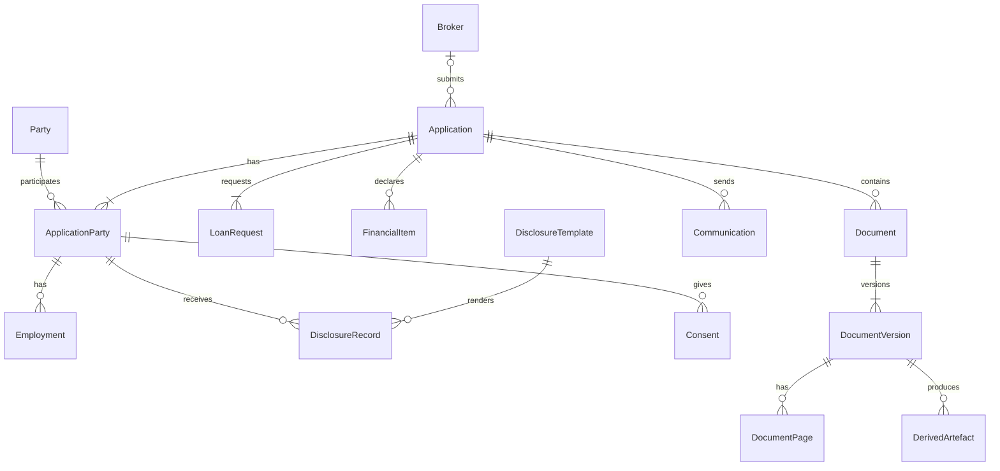
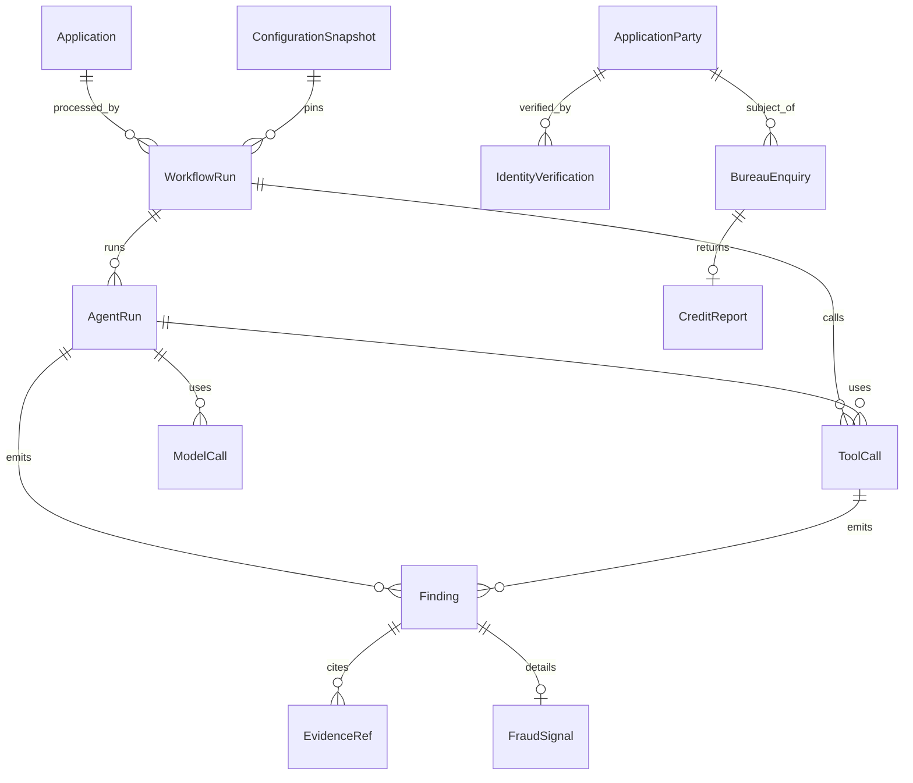
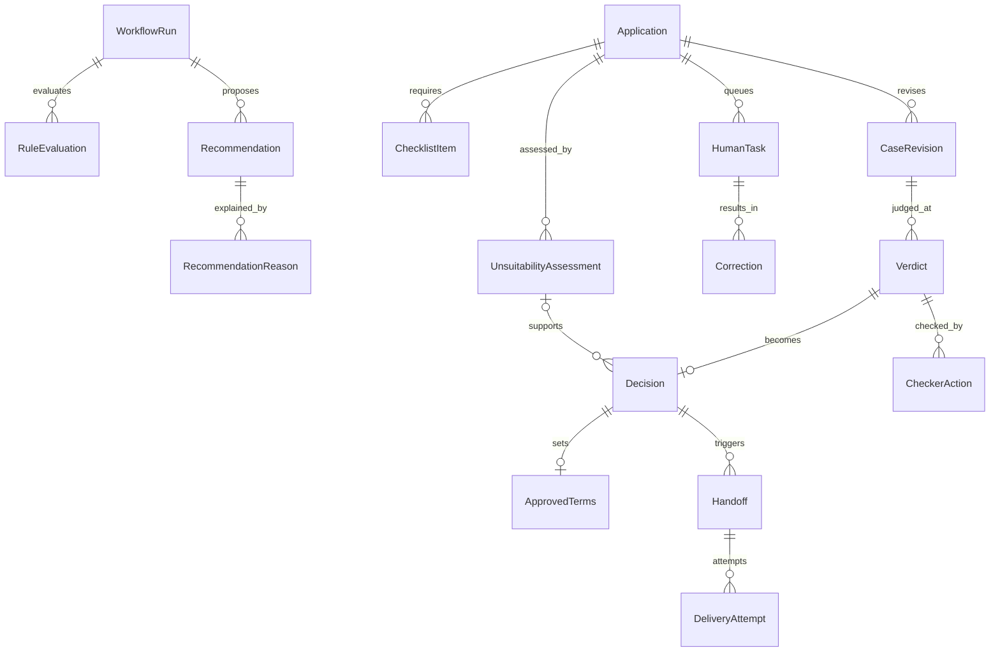
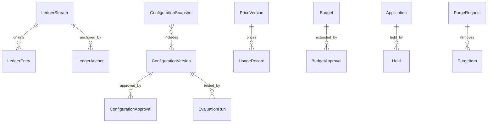
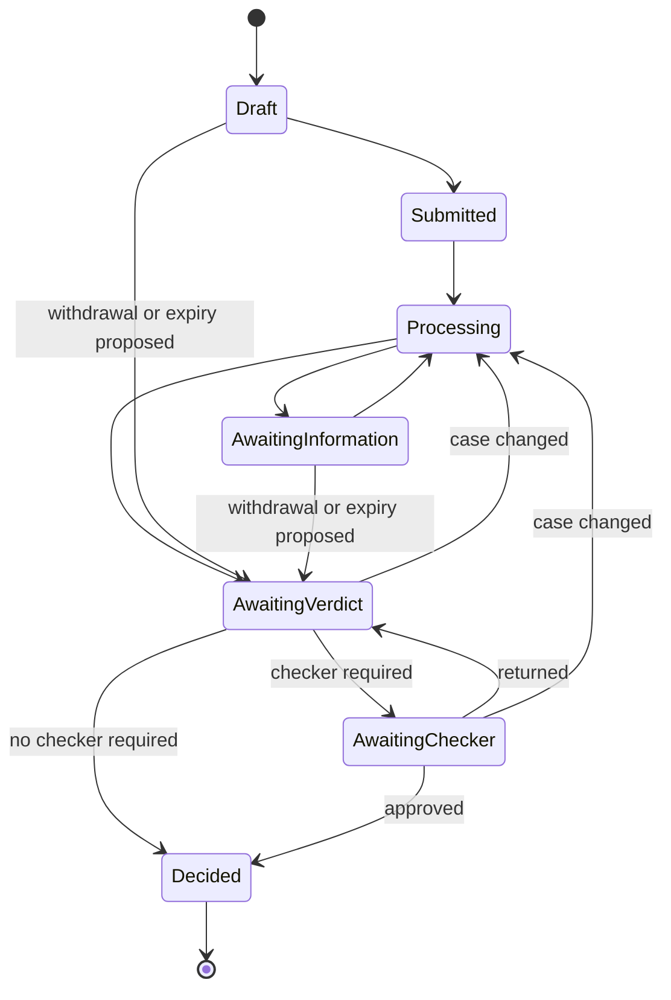
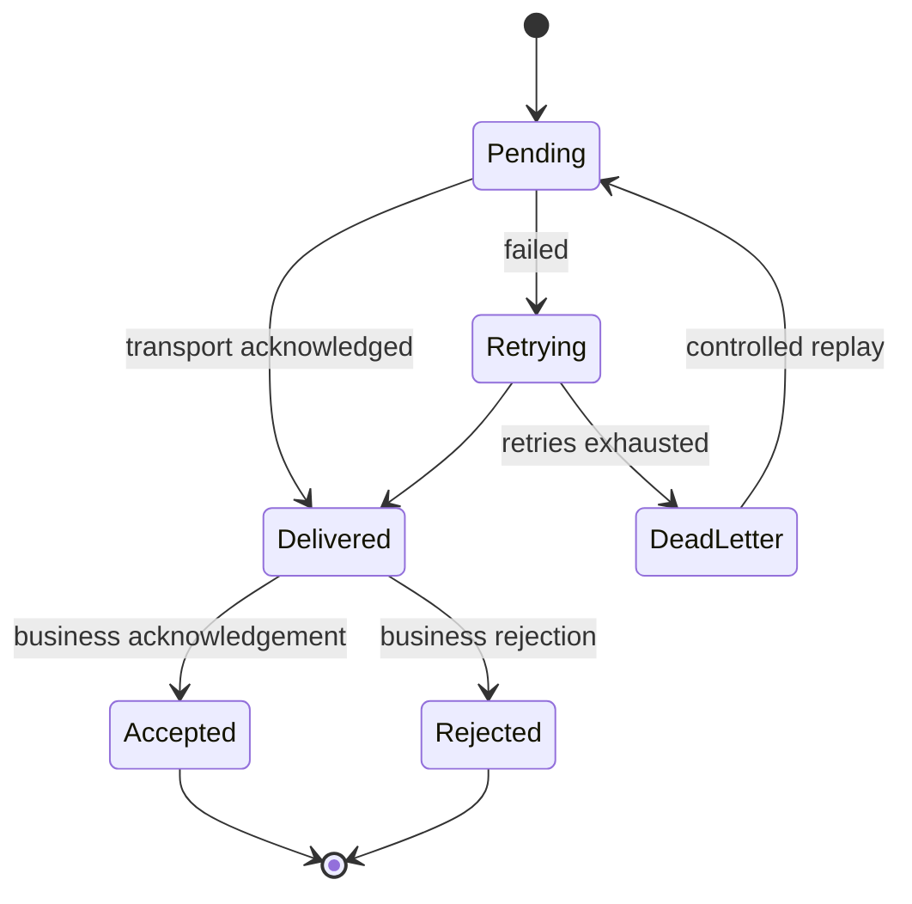

# CreditMate - Domain Model and Metadata Schema v0.2

> Status: DRAFT for review, 2026-11-22.
> Audience: architects and engineers building CreditMate.
> Built on `PROJECT_BRIEF.md` (D-01..D-44, A-01..A-35) and `ARCHITECTURE_DRAFT.md` v0.4.
> v0.2 adds what the source research for `REFERENCE_POLICY.md` showed was missing.
> This is the logical model. Physical DDL follows ADR-003 (database). Open points (DM-xx) are in section 9.

---

## 1. Conventions

| Topic | Convention | Source |
|---|---|---|
| Tenant | Every entity has `tenantId`. Primary, foreign and unique keys all include it | D-36, A-32 |
| Identifiers | Product-generated, opaque, time-ordered UUIDs. Never derived from personal data | |
| Common fields | `createdAt`, `createdBy`, `traceId`, `owner`, `retentionLabel?`. Not repeated in the tables below | A-13 |
| Retention label | Opaque customer value. The product never interprets it | D-39 |
| Time | Instants in UTC. Business dates (pay date, statement period) as dates without time zone | |
| Money | Exact decimal with ISO currency. Never floating point | |
| Change | Evidence, verdicts, decisions and published configuration are immutable; a change creates a new record | |
| Extensibility | Document-type and customer-specific fields are JSON validated by a versioned schema | D-20 |

Data classes used below:

| Class | Meaning | Handling |
|---|---|---|
| **N** | No personal data | May appear in logs as needed |
| **P** | Personal, or linkable to a person | Erasable store; masked by role; never in logs |
| **S** | Sensitive or restricted: identity numbers, bureau data, bank detail, fraud signals | As P, plus field-level encryption and restricted roles |

The ledger and workflow-engine history hold only N data, references and keyed hashes (A-27).

---

## 2. Domains

| Domain | Owns | Module |
|---|---|---|
| Origination | Application, parties, loan request, financial position | Application and Case Service |
| Consent | Disclosures, consents, communications | Disclosure and Consent Service |
| Documents | Documents, versions, pages, copies | Document and Metadata Services |
| Processing | Runs, calls, findings, signals | Orchestrator, Agent Runtime, Tool Broker, Model Gateway |
| Verification | Identity results, bureau enquiries and reports | Tool Broker |
| Assessment | Rule evaluations, recommendations, checklist, unsuitability assessment | Rules Engine |
| Review | Tasks, corrections, verdicts, checker actions, decisions | Human Review Service |
| Audit | Ledger, anchors | Evidence Ledger |
| Handoff | Outbox, handoffs, delivery attempts | Downstream Handoff Service |
| Configuration | Versions, approvals, snapshots, residency exceptions | Configuration and Governance Service |
| Metering | Prices, usage, budgets | Metering and Cost Service |
| Lifecycle | Holds, exports, purges | Retention hooks |

A module writes only its own entities and refers to other domains by ID.

---

## 3. Entity relationships

### 3.1 Origination, consent and documents

### 3.2 Processing and verification

### 3.3 Assessment, decision and handoff

### 3.4 Audit, configuration, metering and lifecycle

Standalone entities: `StaffUser`, `LineageEdge`, `OutboxEvent`, `IdempotencyRecord`, `ExportRequest`, `ResidencyException`, `SupportAccessGrant`.

---

## 4. Entity catalogue

`?` means optional. `[]` means a list.

### 4.1 Origination

| Entity | Key fields | Class | Rules |
|---|---|---|---|
| Application | applicationId, externalRef?, channel, brokerId?, status, assessmentRoute (STANDARD, MANUAL), routeReason?, currentRevision | P | Joint and self-employed cases use MANUAL (A-25) |
| Party | partyId, externalSubject?, name, dateOfBirth, contacts[], addresses[] | S | External identity realm (A-24). No cross-tenant matching |
| ApplicationParty | applicationPartyId, applicationId, partyId, role (PRIMARY, JOINT) | P | Exactly one PRIMARY per application |
| Broker | brokerId, externalSubject, organisation, status | P | Sees only own submissions (A-24) |
| StaffUser | staffUserId, personKey, idpIssuer, subject, roles[], status | P | `personKey` is the same for one human across roles and protocols (D-41, D-42) |
| LoanRequest | loanRequestId, applicationId, revision, amount, termMonths, purpose, requirementsAndObjectives | P | No limits in the schema (D-23) |
| Employment | employmentId, applicationPartyId, type, employerName, startDate, endDate? | P | |
| FinancialItem | itemId, applicationId, applicationPartyId?, kind (INCOME, EXPENSE, LIABILITY, ASSET), category, amount, frequency, basis (DECLARED, EXTRACTED, VERIFIED, BENCHMARK), sourceRef | S | Bases coexist and never overwrite each other (A-22) |

### 4.2 Consent and communication

| Entity | Key fields | Class | Rules |
|---|---|---|---|
| DisclosureTemplate | templateId, version, type, contentHash, effectiveFrom | N | Immutable once published |
| DisclosureRecord | recordId, applicationPartyId, templateId, version, presentedAt, acknowledgedAt?, channel | P | D-22 |
| Consent | consentId, applicationPartyId, purpose (BUREAU, DVS_KYC, AI_PROCESSING, OTHER), wordingVersion, status, grantedAt, withdrawnAt? | P | Checked before the call where policy requires (A-29) |
| Communication | communicationId, applicationId, type, templateVersion, approvedBy?, channel, sentAt?, status | P | Decision communications are human-approved |

### 4.3 Documents

| Entity | Key fields | Class | Rules |
|---|---|---|---|
| Document | documentId, applicationId, applicationPartyId?, type, typeSource (AI, INDEXER), source, currentVersion | P | Agents use only this ID |
| DocumentVersion | versionId, documentId, providerId, repoObjectRef, mime, sizeBytes, sha256, tenantFingerprint, scanStatus, storageState (STAGED, DURABLE, FAILED), receivedAt, holdState | S | Original is never altered. Acknowledge only when DURABLE (A-28) |
| DocumentPage | pageId, versionId, pageNumber, width, height, readability | P | |
| DerivedArtefact | artefactId, versionId, kind (OCR_TEXT, IMAGE, REDACTED, WORKING_COPY, TRACE), storeRef, expiresAt? | S | `expiresAt` applies to ephemeral working copies only, not retention |
| LineageEdge | fromType, fromId, toType, toId, relation | P | Must reach every derived copy so purge is complete |

`tenantFingerprint` is a keyed hash for reused-document detection within one tenant (D-40). It is removed on purge.

### 4.4 Processing

| Entity | Key fields | Class | Rules |
|---|---|---|---|
| WorkflowRun | runId, applicationId, caseRevision, definitionVersion, snapshotId, status, startedAt, endedAt? | P | Versions are pinned for the life of the run |
| AgentRun | agentRunId, runId, agentId, agentVersion, inputRefs[], status, confidence?, validation, attempt | P | |
| ToolCall | toolCallId, runId, agentRunId?, toolId, toolVersion, idempotencyKey, requestRef, responseRef?, status, processingLocation | P | Payloads are held by reference |
| ModelCall | modelCallId, agentRunId, provider, model, modelVersion, promptVersion, params, providerOptions, inputTokens, outputTokens, cachedTokens, latencyMs, status, processingLocation, residencyExceptionId? | P | No prompt or response text. Location is AU unless an exception is linked (D-31) |
| Finding | findingId, applicationId, producerType, producerRunId, type, value, unit?, confidence, supersedesId? | S | At least one EvidenceRef |
| EvidenceRef | evidenceRefId, findingId, sourceType, sourceId, page?, region?, jsonPath? | P | Must resolve within the same tenant and application |
| FraudSignal | findingId, checkId, checkVersion, origin (TOOL, AGENT), result (SIGNAL, NO_SIGNAL, NOT_ASSESSABLE), severity?, observed?, expected?, innocentExplanations[] | S | No verdict field. TOOL rows cannot be superseded by an agent (D-40) |

For a reused-document signal, the evidence is the current document plus an opaque match reference, which only authorised roles can resolve. This keeps the other applicant's data out of the case.

### 4.5 Verification

| Entity | Key fields | Class | Rules |
|---|---|---|---|
| IdentityVerification | verificationId, applicationPartyId, method (DVS, KYC_PROVIDER, MANUAL), outcome, providerRef?, verifiedBy?, evidenceRefs[], completedAt | S | Method follows customer policy (D-26) |
| BureauEnquiry | enquiryId, applicationPartyId, providerId, consentId?, idempotencyKey, state (CREATED, SENT, UNKNOWN, COMPLETED, FAILED), providerRef? | S | UNKNOWN is reconciled, never blindly retried (A-30) |
| CreditReport | reportId, enquiryId, canonicalVersion, score?, scoreScale?, hasRepaymentHistory, hasHardshipInfo, summary, rawPayloadRef | S | Scores keep their scale and are never compared across bureaus (D-28) |

### 4.6 Assessment

| Entity | Key fields | Class | Rules |
|---|---|---|---|
| RuleEvaluation | evaluationId, runId, ruleSetVersion, ruleId, inputRefs[], inputValuesRef, outcome, reasonCode? | P | Reproducible from its stored inputs |
| Recommendation | recommendationId, runId, source (RULES, AGENT), outcome (RECOMMEND_APPROVE, REFER, RECOMMEND_DECLINE), summaryRef?, confidence? | P | Not a decision. No AGENT row on a MANUAL route (A-25) |
| RecommendationReason | reasonId, recommendationId, reasonCode?, ruleEvaluationId?, findingIds[] | P | Decline and referral reason codes come from rules (D-08) |
| ChecklistItem | itemId, applicationId, requirementCode, policyVersion, status, completedBy?, evidenceRefs[] | P | Responsible-lending evidence |
| UnsuitabilityAssessment | assessmentId, applicationId, revisionId, inquiriesCompletedAt, verificationCompletedAt, assessedAt, periodStart, periodEnd, validUntil, outcome (NOT_UNSUITABLE, UNSUITABLE), assessedBy, evidenceRefs[], documentRef | S | Immutable and human-confirmed. validUntil is no later than 90 days after the earliest relied-on inquiry, verification or assessment (NCCP ss 128-129). Exportable as a written copy (s 132) |

### 4.7 Review and decision

| Entity | Key fields | Class | Rules |
|---|---|---|---|
| HumanTask | taskId, applicationId, type (INDEX_EXCEPTION, ASSESS, CHECK, NOTICE, OPERATIONS), queue, assignee?, status, openedAt, activeSeconds, completedAt? | P | `activeSeconds` supports oversight metrics (A-18) |
| Correction | correctionId, taskId, targetType, targetId, newValueRef, reason, correctedBy | S | Creates a new revision and re-runs dependent steps (D-25) |
| CaseRevision | revisionId, applicationId, number, cause, contentManifestHash | P | New revision on any change to data, documents or findings |
| Verdict | verdictId, revisionId, makerPersonKey, outcome, rationale, recommendationId?, deviatesFromRecommendation, checkerRequired, triggerRuleRefs[], status (SUBMITTED, RETURNED, INVALIDATED, FINALISED) | P | Human only |
| CheckerAction | actionId, verdictId, checkerPersonKey, action (APPROVE, RETURN), rationale, actedAt | P | Checker is never the maker (D-42) |
| Decision | decisionId, applicationId, verdictId, outcome (APPROVED, DECLINED, WITHDRAWN, EXPIRED), decidedBy, decidedAt, reasonCodes[], assessmentId?, creditInfoReliedOnPartyIds[], supersedesId? | P | Immutable. Requires a human Verdict (D-15, A-26) |
| ApprovedTerms | decisionId, amount, termMonths, pricingRef?, conditions[] | P | See DM-01 and DM-02 |

### 4.8 Audit

| Entity | Key fields | Class | Rules |
|---|---|---|---|
| LedgerStream | streamId, kind (APPLICATION, CONFIGURATION, ACCESS), subjectRef, lastSequence, lastHash | N | One chain per application |
| LedgerEntry | entryId, streamId, sequence, prevHash, hash, eventType, actorType, actorRef, subjectRefs[], valueHmacs[], versionRefs[], occurredAt | N | Append-only. No personal values or free text |
| LedgerAnchor | anchorId, streamId, sequence, hash, signature, exportedTo | N | Detects rewriting or truncation by a privileged user |

### 4.9 Handoff and messaging

| Entity | Key fields | Class | Rules |
|---|---|---|---|
| OutboxEvent | eventId, aggregateId, sequence, eventType, schemaVersion, payloadRef, publishedAt? | P | Written in the same transaction as the change |
| Handoff | handoffId, decisionId, destinationId, destinationVersion, mappingVersion, payloadVersion, assessmentValidUntil?, idempotencyKey, state | P | Unique per decision and destination |
| DeliveryAttempt | attemptId, handoffId, number, sentAt, result, externalAckRef?, errorCode? | P | Error text is sanitised |
| IdempotencyRecord | clientId, key, requestHash, resultRef, expiresAt | P | Same key with a different request is rejected |

### 4.10 Configuration and access

| Entity | Key fields | Class | Rules |
|---|---|---|---|
| ConfigurationVersion | configVersionId, kind (RULE_SET, PROMPT, MODEL_PROFILE, AGENT, WORKFLOW, DOCUMENT_TYPE, INTEGRATION, CHECKER_TRIGGER), name, version, body, origin (REFERENCE, LENDER), state, effectiveFrom?, authorPersonKey | N | Secrets are references. REFERENCE is inactive until approved (A-35) |
| ConfigurationApproval | approvalId, configVersionId, approverPersonKey, action, actedAt | N | Approver is not the author (A-07) |
| EvaluationRun | evaluationRunId, configVersionId, datasetVersion, metrics, passed | N | Required before promoting prompts and models |
| ConfigurationSnapshot | snapshotId, configVersionIds[], hash | N | Immutable |
| ResidencyException | exceptionId, dataClasses[], destination, purpose, approvedBy, expiresAt | N | D-31 |
| SupportAccessGrant | grantId, supportSubject, scope, location, masked, approvedBy, expiresAt, revokedAt? | P | A-08 |

### 4.11 Metering

| Entity | Key fields | Class | Rules |
|---|---|---|---|
| PriceVersion | priceVersionId, provider, item, unit, unitPrice, currency, effectiveFrom | N | |
| UsageRecord | usageId, callType, callId, priceVersionId, quantity, cost | N | Vendor bill-back receives aggregates only (A-17) |
| Budget | budgetId, scope, period, limit, alertThresholds[] | N | |
| BudgetApproval | approvalId, budgetId, additionalAmount, approvedBy, expiresAt | N | Manual review continues while pending (A-20) |

### 4.12 Lifecycle hooks

| Entity | Key fields | Class | Rules |
|---|---|---|---|
| Hold | holdId, applicationId, documentId?, externalRef, setBy, setAt, clearedAt? | P | An active hold blocks purge |
| ExportRequest | exportId, scope, requestedBy, formatVersion, resultRef?, status | P | Open format (D-39) |
| PurgeRequest | purgeId, scope, externalRef, requestedBy, status, completedAt? | N | Customer-initiated only; no scheduler |
| PurgeItem | itemId, purgeId, targetType, targetId, result, errorCode? | N | Reports anything not deleted |

---

## 5. State models

### 5.1 Application

Only a human action can enter `Decided`. Processing failures create a task and move to `AwaitingVerdict` for manual assessment; they never close a case. A withdrawal requested during `Processing` cancels the run and moves to `AwaitingVerdict`.

### 5.2 Handoff

A rejected handoff raises an operations task and never changes the decision.

---

## 6. Invariants

Each invariant needs an automated negative test.

| ID | Invariant | Enforced by | Source |
|---|---|---|---|
| INV-01 | No reference crosses a tenant | Composite foreign keys, two-tenant tests | A-32 |
| INV-02 | Every Decision has a human Verdict | Foreign key, permission limited to human principals | D-15 |
| INV-03 | Maker and checker are different people | Constraint on `personKey` | D-42 |
| INV-04 | A Decision uses the current CaseRevision | Compare-and-set in the decision transaction | D-42 |
| INV-05 | A required checker has approved that exact Verdict | Decision transaction | D-42 |
| INV-06 | Decision, ledger entry and outbox event commit together | One database transaction | D-11, D-37 |
| INV-07 | Every Finding has resolvable evidence | AI Harness and write transaction | D-08 |
| INV-08 | An agent cannot remove or lower a tool signal | No update permission, supersession check | D-40 |
| INV-09 | A missing fraud result is never NO_SIGNAL | Explicit NOT_ASSESSABLE | D-40 |
| INV-10 | A non-AU call links a valid exception | Gateway and Tool Broker, before the call | D-31 |
| INV-11 | Configuration author is not its approver | Constraint on `personKey` | A-07 |
| INV-12 | Unapproved reference policy cannot run in production | Activation check | A-35 |
| INV-13 | Ledger and workflow history contain no personal values | Typed schemas, automated PII scan | A-27 |
| INV-14 | Purge cannot override a hold | Purge transaction | D-39 |
| INV-15 | Published configuration, ledger entries and decisions are never updated | Database permissions | D-06 |
| INV-16 | Upload success is returned only for DURABLE versions | Document Service | A-28 |
| INV-17 | An APPROVED Decision references a current, unexpired NOT_UNSUITABLE assessment | Decision transaction | NCCP ss 128, 133 |
| INV-18 | An approval handoff carries `assessmentValidUntil` and cannot be sent or replayed after it | Handoff Service | NCCP s 128 |
| INV-19 | A decline relying on bureau data creates a notice task | Decision transaction | Privacy Act s 21P |
| INV-20 | Every use or disclosure of bureau-derived data writes an ACCESS ledger entry | Tool Broker, Gateway, APIs | Privacy Act s 21G(6) |
| INV-21 | No applicant-facing output states unconditional eligibility before a current assessment exists | Notification service, portal, output guardrail | NCCP s 128(aa) |
| INV-22 | Protected attributes, including those inferred from transactions, are not rule or recommendation inputs | Configuration review, Gateway, evaluation | SDA s 22, DDA s 24 |

---

## 7. Audit integrity with purge

1. Personal values live in the erasable entities above or in encrypted objects.
2. A ledger entry stores references and an HMAC of each value, using a key specific to that application.
3. The chain hash covers the stored entry only, so verification needs neither the value nor the key.
4. A purge deletes the values, objects, lineage-linked copies and fingerprints, then destroys the application's HMAC key and appends `PURGE`.
5. After purge the chain still proves order, actors and versions. It cannot prove or reveal the values.
6. Opaque references that remain may still be linkable through backups or downstream systems until the customer expires those copies. Counsel should confirm that the remainder is acceptably de-identified.

---

## 8. Physical design notes (subject to ADR-003)

| Topic | Guidance |
|---|---|
| Keys | `(tenantId, id)` primary keys. Every index leads with `tenantId` |
| Work queues | Partial index on open tasks by queue and `openedAt` |
| Case view | Index child tables by `(tenantId, applicationId)`; denormalise `applicationId` where needed |
| Uniqueness | Idempotency keys, `(streamId, sequence)`, `(applicationId, revision number)`, `(decisionId, destinationId)` |
| JSON | Only for schema-validated variable fields. Fields used in rules or joins are typed columns |
| Large payloads | Object storage by reference: OCR text, raw bureau responses, traces, exports |
| Volume | At D-10, a 250-day year is about 250K applications, 2M documents and 5M model calls per lender. Plan partitioning for calls, ledger and attempts |
| Separation | Separate database roles per module and for ledger append and purge |
| Durability | Synchronous replication for decision and upload transactions (A-28) |

---

## 9. Open points

| ID | Question | Interim treatment | Blocks |
|---|---|---|---|
| DM-01 | Who sets interest rate and fees: this product or an external pricing system? Affordability needs a repayment amount, and the brief does not cover pricing | `pricingRef` placeholder | Affordability rules, handoff payload |
| DM-02 | Can an assessor approve with conditions or different terms (counter-offer)? | Fields exist; no workflow | Review workflow, portal |
| DM-03 | Can a final decision be reopened or reconsidered? | New Decision supersedes the old one; no reopen workflow | Review workflow, handoff |
| DM-04 | Does an applicant's own withdrawal need staff confirmation? | Yes | Portal |
| DM-05 | Which system sends the s 21P refusal notice, and what other notices apply? The s 21P trigger is known (INV-19) | Notice task created; sender open; counsel to confirm | Portal, notifications |
| DM-06 | How are tax file numbers in uploaded documents handled? | Not extracted; masked in derived copies; original restricted; counsel to confirm against TFN Rule ss 9 and 11 | Extraction |
| DM-07 | Are applicants matched across applications within a lender? | No automatic merge | Fraud screening |
| DM-08 | Who performs PEP and sanctions screening (PQ-01)? | No entity until scope is decided | Identity, handoff |
