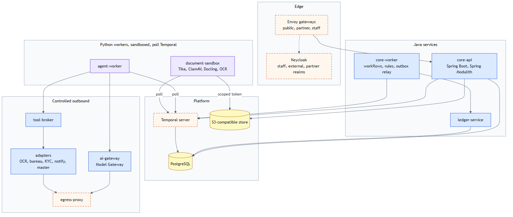
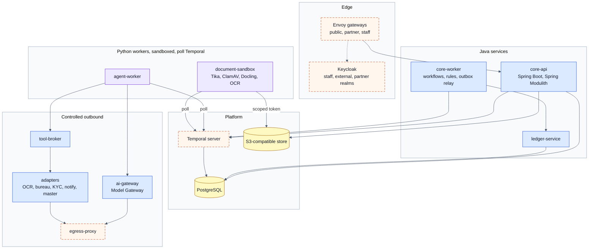
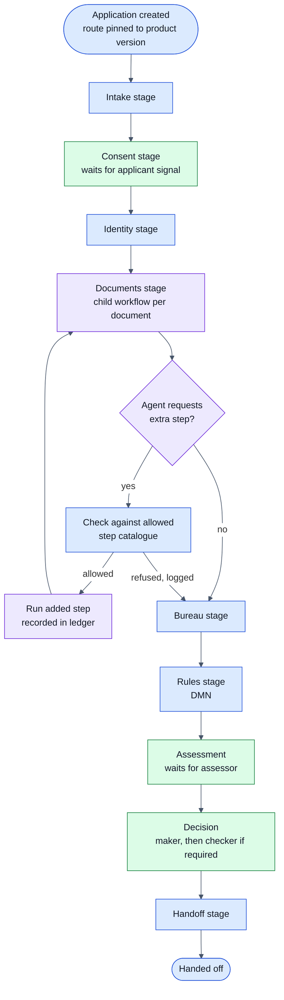
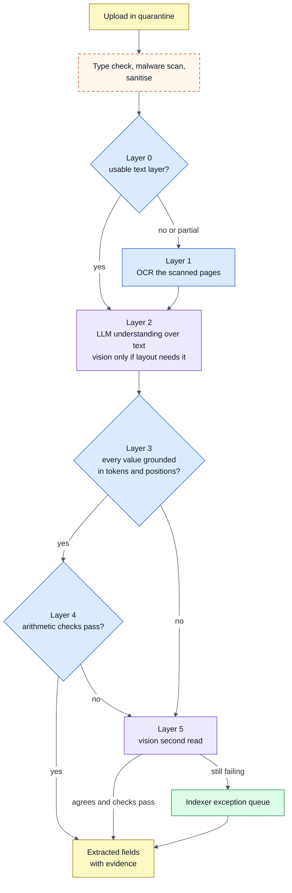
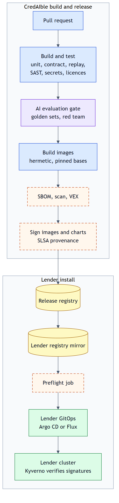
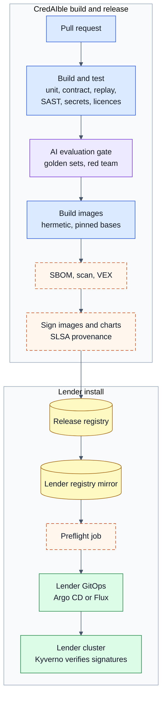

# CredAIble - Technical Design v0.1

| Item | Value |
|---|---|
| Status | Draft for review |
| Date | 2026-11-27 |
| Audience | CredAIble engineers and architects; lender platform, security and architecture teams |
| Builds on | `ARCHITECTURE_DRAFT.md` v0.5, `ARCHITECTURE_DIAGRAMS.md` v0.3, `DOMAIN_MODEL.md` v0.3, `PROJECT_BRIEF.md` (2026-11-27) |
| Decisions added | D-57 to D-66 (`PROJECT_BRIEF.md` section 5) |
| ADRs added or changed | ADR-033 to ADR-042; ADR-003 to ADR-007, ADR-009 to ADR-012 and ADR-021 updated (section 23) |

The architecture draft says **what** the system does and **why**. This document says **how it is built**: languages, frameworks, products, conventions and the engineering rules that keep it secure, portable and cheap to run inside each lender's environment.

---

## 1. Purpose and scope

In scope:

- The technology choice for every layer, with a fallback where the lender may already run an equivalent.
- How each deployable is built, and in which language and framework.
- The process model and how the workflow engine enforces it.
- The AI runtime: agents, Model Gateway, document pipeline and layered extraction.
- Data, API, identity, frontend, security, supply chain, observability and packaging conventions.
- The value dashboard, which is in the first release (D-64).
- Testing, AI evaluation, repository layout and CI.

Out of scope: credit policy content (`REFERENCE_POLICY.md`), commercial terms, and the detailed screen design.

Everything in this document is a design proposal until the ADRs in section 23 are accepted. Figures for sizing and cost are illustrative until measured.

---

## 2. Design principles

| # | Principle | What it means in practice |
|---|---|---|
| P1 | **The lender's environment is the product's environment** | Everything runs in the lender's cluster. We integrate with what the lender already runs and ship a fallback only where needed (section 19) |
| P2 | **Deterministic route, agentic steps** | The product configuration fixes the route. AI works inside steps and may add work, never remove it (D-58, section 7) |
| P3 | **Evidence or rejection** | Every AI output is schema-validated and grounded in a source document region, or it is rejected (section 10.4) |
| P4 | **A person decides** | No code path approves or declines credit without a named human action (ADR-002) |
| P5 | **Boring, standard technology** | Mainstream languages, open standards and widely run open-source projects that lender platform teams already know |
| P6 | **Few moving parts** | PostgreSQL does most data jobs. No message broker inside the product. Few deployables with enforced module boundaries (A-16) |
| P7 | **Permissive licences only in what we ship** | Section 3 |
| P8 | **Secure by default, verifiable by the lender** | Signed images, SBOMs, restricted pod security, default-deny networking, a preflight report the lender can read (sections 15, 16, 19) |
| P9 | **Cost is a design input** | Text layer before OCR, OCR before vision, small models before large ones, scale to zero when idle, every model call metered (sections 9, 10, 20) |
| P10 | **Contracts first** | OpenAPI, AsyncAPI and JSON Schema are written before code and generate clients, validators and documentation (section 12) |

---

## 3. Licence policy (ADR-037, proposed)

| Category | Rule |
|---|---|
| Shipped in CredAIble images or charts | Apache 2.0, MIT, BSD, ISC, MPL 2.0 or EPL 2.0 only |
| Optional reference components | AGPL allowed only as unmodified, separately deployed containers the lender can replace (for example Grafana, Loki, Tempo in the optional observability profile) |
| Not allowed | BSL, SSPL, Elastic License, Commons Clause, "source available" licences, and any GPL or AGPL code linked into our own services |
| Enforcement | SBOM licence scan in CI fails the build on a disallowed licence; exceptions need an ADR |

This is why the design uses OpenTofu rather than Terraform, OpenBao rather than Vault, OpenSearch rather than Elasticsearch, Valkey rather than Redis, and Apicurio rather than Confluent Schema Registry. Licence terms are checked again at each dependency upgrade.

---

## 4. Technology stack by layer

"Lender" means the product integrates with the lender's existing service; "Bundled" means CredAIble ships it; "Either" means the lender's service is preferred and a bundled fallback exists (section 19.1).

| Layer | Choice | Fallback or alternative | Source | Notes |
|---|---|---|---|---|
| Core service language | **Java 25 (LTS)** | Next LTS when released | Bundled | D-57. Virtual threads for I/O-bound work |
| Core framework | **Spring Boot** (current major line) with Spring Security, Spring Data JDBC or JPA, Spring Modulith | - | Bundled | Spring Modulith enforces module boundaries inside one deployable (A-16) |
| AI worker language | **Python 3.13** | 3.14 once dependencies support it | Bundled | D-57. Only in agent-worker and document-sandbox |
| AI worker libraries | Temporal Python SDK, Pydantic v2, Pydantic AI (optional), httpx | - | Bundled | No database drivers installed (section 8) |
| Frontend | **TypeScript, React, Vite**, React Aria, TanStack Query, Zod, PDF.js | - | Bundled | Section 14 |
| Workflow engine | **Temporal** (self-hosted, MIT) on PostgreSQL | - | Bundled | D-59, ADR-004 |
| Rules engine | **Apache KIE (Drools) DMN** | Operaton DMN | Bundled | ADR-005 |
| Database | **PostgreSQL 17+** | CloudNativePG operator | Either | ADR-003. Metadata, ledger, outbox, Temporal store, search, vectors |
| Object storage | **S3-compatible** (AWS S3, Ceph RGW, MinIO-compatible, NetApp StorageGRID) | Azure Blob adapter | Lender (required in production) | ADR-008, DG-06 |
| Cache | None initially | Valkey | Bundled if needed | Add only for a measured need |
| Search | PostgreSQL `pg_trgm` and full-text search | OpenSearch | Bundled if needed | Name and address matching, case search |
| Vector store | `pgvector` | - | Bundled | Policy and guidance retrieval only; never for credit facts |
| Eventing inside the product | **Transactional outbox** in PostgreSQL | - | Bundled | ADR-006. No internal broker |
| Eventing to the lender | Kafka-compatible producer, webhooks, REST | - | Lender's broker | Handoff adapter only (ADR-019) |
| Schemas | OpenAPI 3.1, AsyncAPI 3, JSON Schema 2020-12, CloudEvents 1.0 | - | Bundled | Section 12 |
| Schema registry | **Apicurio Registry** | Schemas in the repo only | Bundled (optional) | Needed when Kafka handoff is used |
| Identity | **Keycloak** | - | Bundled | ADR-021. Federates to the lender's IdP |
| Authorization | **OPA** (Wasm in process, or sidecar) | - | Bundled | ADR-007. Hard invariants stay in code |
| Gateways | **Envoy Gateway** on Kubernetes Gateway API | Lender's ingress in front | Bundled | ADR-039. public, partner and staff gateways |
| Egress | **Envoy** egress proxy with allow-list | Lender's proxy upstream | Bundled | DG-05 |
| WAF and DDoS | Lender's WAF and CDN | Coraza with OWASP Core Rule Set in the gateway | Lender | Fallback is a minimum, not a substitute |
| Service-to-service TLS | **Istio ambient** if the lender runs it | cert-manager issued certificates, TLS in the application | Either | Linkerd avoided because of its stable-release licence terms |
| Secrets | Lender's secrets manager via **External Secrets Operator** | **OpenBao** | Either | ADR-040 |
| Envelope encryption | **Google Tink** with the lender's KMS or HSM | Tink with a bundled key file (Evaluation only) | Lender | ADR-040 |
| Certificates | **cert-manager** | Lender's PKI as issuer | Bundled | |
| Malware scanning | Lender's ICAP service | **ClamAV** | Either | Section 10.2 |
| File type detection | **Apache Tika** | - | Bundled | Magic bytes, never the file name |
| PDF sanitising | **qpdf** normalisation; rasterising for risky files | - | Bundled | |
| Document parsing | **Docling** | - | Bundled | Layout, tables and text layer |
| OCR | Lender-approved cloud OCR in an AU region | **PaddleOCR** or **Tesseract** on-premises | Either | ADR-010 |
| Models | AU-region hosted models: AWS Bedrock (Sydney), Google Vertex AI (Sydney), Azure OpenAI (Australia East) | vLLM self-hosted (later, D-63) | Lender contracts (D-61) | Through the Model Gateway only |
| AI evaluation | In-house evaluation harness, **promptfoo** for prompt regression | - | Bundled in CI | Section 21 |
| Autoscaling | HPA, **KEDA** | - | Bundled | Section 20 |
| Admission policy | **Kyverno** | Lender's Gatekeeper policies | Either | Section 15 |
| Observability | **OpenTelemetry** SDKs and Collector | Optional Prometheus, Grafana, Loki, Tempo profile | Either | ADR-011 |
| Infrastructure as code | **OpenTofu** modules, **Helm** charts | - | Bundled | Section 19 |
| Delivery | **Argo CD** or **Flux** (lender's choice) | Plain Helm | Lender | |
| Base images | Red Hat **UBI micro** or **distroless** | - | Bundled | Section 16 |

---

## 5. Deployables, languages and frameworks

The deployable list and allowed connections are in `ARCHITECTURE_DIAGRAMS.md` section 3A. This table adds how each one is built.

| Deployable | Language and framework | Key libraries | State | Notes |
|---|---|---|---|---|
| portal-web | TypeScript, React, Vite | React Aria, TanStack Query, Zod, PDF.js | None (static) | Applicant and broker portals on separate host names; served by a hardened static server image |
| backoffice-web | TypeScript, React, Vite | as above, plus the value dashboard (section 18) | None (static) | |
| public-gateway, partner-gateway, staff-gateway | Envoy Gateway configuration | Gateway API, Envoy ext_authz, OAuth2 filter, Coraza (fallback) | None | Separate Gateway resources, listeners and policies per zone (ADR-030) |
| identity-broker | Keycloak | Custom themes and a small Java SPI for one-time code login | Its own PostgreSQL database | Realms: staff, external, partner (section 13) |
| core-api | Java, Spring Boot, Spring Modulith | Spring Security (resource server), Flyway, jOOQ or Spring Data JDBC, OPA Wasm, Tink, OpenTelemetry Java agent | PostgreSQL schemas per module | Modules from draft section 27.16 and diagrams section 3A |
| core-worker | Java, Spring Boot, Temporal Java SDK | Apache KIE DMN, Flyway (none: uses core-api schemas through module APIs), outbox relay | PostgreSQL | Runs workflow definitions and non-AI activities |
| workflow-engine | Temporal server | PostgreSQL persistence and visibility | PostgreSQL database `temporal` | Section 7.9 |
| ledger-service | Java, Spring Boot | Hash chain, Tink signatures | PostgreSQL schema `ledger`, own role | ADR-003, ADR-014 |
| agent-worker | Python, Temporal Python SDK | Pydantic v2, optional Pydantic AI, httpx | None | Section 8 |
| ai-gateway | Java, Spring Boot | Provider SDKs or plain HTTP clients, JSON Schema validator, Resilience4j | Prompt and model registry read from core-api | Section 9 |
| tool-broker | Java, Spring Boot | Resilience4j | None | Holds no provider credentials; adapters do |
| adapters (ocr, bureau, kyc, notification, customer-master, lixi) | Java, Spring Boot, one shared chart template | Provider SDK or HTTP client | None | One instance per provider (draft section 20) |
| document-sandbox | Python | Apache Tika (server), ClamAV or ICAP client, qpdf, Docling, PaddleOCR or Tesseract | Scratch volume only | Strongest isolation in the product (section 10.2) |
| self-hosted-model | vLLM | - | Model weights volume | Later phase (D-63) |
| egress-proxy | Envoy | - | None | Allow-list per destination |
| telemetry-collector | OpenTelemetry Collector (contrib distribution, pinned) | Redaction and transform processors | None | Strips personal data (section 17) |

**Why Java for the core and Python only for AI (D-57).** Java has the strongest ecosystem for the transactional, security and integration work in the core, and is the language most lender platform teams already operate and audit. Python has the best AI and document libraries. Keeping Python to sandboxed workers with no data credentials limits the larger dependency surface that comes with it. TypeScript is used for browser code only, and Node.js is not run on the server.

---

## 6. Runtime view



<!-- diagram: tdd-1-runtime -->


Workers **poll** Temporal for tasks; nothing calls into a worker. That keeps the Python workers free of inbound network access. The document-sandbox reads one document at a time through a scoped, short-lived object-store credential issued by core-api, and writes only derived artefacts to a staging prefix.

---

## 7. Process model and Temporal design (D-58, D-59, ADR-004, ADR-034)

### 7.1 The model

The route an application takes is **deterministic**: it is read from the product definition (D-54) when the application is created and pinned to that product version. Inside a step, AI agents behave **agentically**: they choose tools, reason over documents, and may request **additional** steps such as a second read, an extra document request or a referral. They can never remove, reorder or bypass a step the route requires.

Why not let an agentic orchestrator choose the route:

- **Mandatory controls.** Consent, identity verification, maker and checker and the human decision are legal and policy obligations. A model must not be able to talk its way past them, including through prompt injection in an uploaded document.
- **Reproducibility.** A regulator, auditor or complainant asks what happened and why. A fixed route with recorded additions can be replayed and explained; a model-chosen route cannot.
- **Operability.** Retries, timeouts, compensation and versioning are solved problems in a workflow engine and are fragile in an agent loop.

### 7.2 Route definition

A product definition contains a `process` section, versioned with the rest of the product (ADR-029):

```yaml
process:
  version: 3
  stages:
    - id: intake          # canonical intake, checklist, duplicate check
      mandatory: true
    - id: consent         # ADR-026 consent gate
      mandatory: true
    - id: identity
      mandatory: true
    - id: documents       # collection, layered extraction, cross-checks
      mandatory: true
      agents: [classifier, extractor, income-analyst, statement-analyst, cross-checker, fraud-screen]
      allowAgentAdded: [second-read, document-request, specialist-review]
    - id: bureau
      mandatory: true
    - id: rules           # DMN eligibility, affordability, referral
      mandatory: true
    - id: assessment      # human review with drafted summary
      mandatory: true
      human: assessor
    - id: decision        # maker, optional checker (ADR-023, D-50)
      mandatory: true
      human: [maker, checker?]
    - id: handoff
      mandatory: true
```

The Configuration and Governance Service validates a definition on publish: every stage the product type requires is present and `mandatory`, human stages have a role, and agent-added step types are drawn from a fixed catalogue.

### 7.3 Workflow structure


<!-- diagram: tdd-2-workflow -->


- One **ApplicationWorkflow** per application, written in Java. Its workflow ID is the application ID, so a second start is rejected.
- The workflow iterates over the pinned stage list. It does not contain product logic itself; stage handlers are Java classes selected by stage ID.
- Each document is a **child workflow** (`DocumentWorkflow`) so documents are processed in parallel and a slow document does not block the others.
- Agent work runs as **activities** on Python task queues. An activity returns a schema-validated result or fails.
- Withdrawal, lapse and cancellation are signals that end the workflow through a defined compensation path (revoke links, stop timers, record in the ledger).

### 7.4 "Agents add, never skip": how it is enforced

| Layer | Enforcement |
|---|---|
| Configuration | Mandatory stages and the allowed agent-added step catalogue are validated when a product is published |
| Workflow code | The stage list is iterated by Java workflow code. No activity result can change the list's order or remove an entry. An agent result can only carry an `additionalSteps` array |
| Contract | `additionalSteps` entries are validated against the catalogue and the stage's `allowAgentAdded`; anything else is refused and recorded as a guardrail event |
| Limits | A per-application cap on added steps and on spend stops loops (section 9.5) |
| Evidence | Every added or refused step is a ledger entry with the agent, prompt version and reason |
| Tests | A property test generates random agent outputs and proves that every mandatory stage still runs (section 21) |

### 7.5 Human tasks

- Human work (consent, document upload, assessment, decision) is a **wait** in the workflow for a Temporal **Update** (validated, acknowledged) or **Signal** sent by core-api after it has saved the human action (ADR-015).
- core-api owns the work queue tables that the back office reads; the workflow does not serve screens.
- Maker and checker rules (ADR-023, D-50) are checked twice: in core-api when the action is submitted and in the workflow before the decision is accepted.

### 7.6 Timers

| Timer | Source | Behaviour |
|---|---|---|
| Secure link expiry | A-39 (7 days, configurable) | Link revoked; applicant can request a new one |
| Reminders | A-39 (days 2, 5 and 7) | Notification activity; sends nothing after withdrawal |
| Lapse | A-39 (30 days after the last outstanding request) | Application lapses; broker and applicant told |
| Provider callback timeout | Per adapter | Reconcile, never assume a clean result |
| Human task SLA | Per product | Escalation to a queue, not an automatic decision |

Timers are durable Temporal timers, so they survive restarts and upgrades.

### 7.7 Task queues

| Task queue | Worker | Work |
|---|---|---|
| `app-workflows` | core-worker | ApplicationWorkflow, DocumentWorkflow |
| `core-activities` | core-worker | Rules, ledger writes, notifications, handoff, registry |
| `doc-sandbox` | document-sandbox | Type detection, malware scan, sanitising, text layer, OCR |
| `agents-standard` | agent-worker | Classification, extraction, analysis |
| `agents-priority` | agent-worker | Re-runs requested by an assessor |
| `provider-calls` | core-worker | Calls through the tool-broker to bureau, KYC and OCR adapters |

Separate queues let KEDA scale each worker type on its own backlog (section 20) and keep a provider outage from starving other work.

### 7.8 Versioning and upgrades

- Workflow code changes use Temporal **Worker Versioning** (worker deployments with build IDs): running workflows finish on the version that started them, new workflows start on the new one.
- Small compatible changes inside a version use `Workflow.getVersion` patches; patches are removed only after every workflow that used them has closed.
- Replay tests run in CI against recorded histories from the previous release (section 21).
- Activity inputs and outputs are versioned JSON Schemas; a breaking change creates a new activity type.

### 7.9 Temporal deployment

| Item | Design |
|---|---|
| Persistence | PostgreSQL (separate database `temporal`, separate role), same cluster as the product in Standard profile, separate cluster allowed in Enterprise |
| Visibility | PostgreSQL advanced visibility; no Elasticsearch |
| Services | frontend, history, matching, worker as separate deployments in Enterprise; a single combined deployment for Standard and Evaluation |
| Security | mTLS between Temporal services and clients; namespace per installation; a payload codec encrypts workflow and activity payloads with Tink, so personal data is not stored in clear in Temporal history |
| Retention | Closed workflow history kept for a short configurable period (for example 30 days); the evidence ledger, not Temporal, is the long-term record |
| Web UI | Optional, staff realm only, read-only role by default |
| Operations | Runbooks for shard count choice, history size limits and upgrades; Temporal server upgrades follow their supported sequence one minor version at a time |

---

## 8. Agent runtime (Python)

### 8.1 Isolation

| Control | Setting |
|---|---|
| Credentials | No database or object-store credentials. Inputs arrive in the activity payload or through a short-lived, single-object read token issued by core-api |
| Network | Default-deny NetworkPolicy; egress only to Temporal frontend, ai-gateway and tool-broker |
| Pod security | Non-root, read-only root file system, no privilege escalation, all capabilities dropped, `RuntimeDefault` seccomp, small `emptyDir` for scratch |
| Image | Distroless Python base, dependencies locked with hashes (`uv.lock`), no shell |
| Outputs | Pydantic models generated from the activity JSON Schema; the Java side validates again before use |

### 8.2 Agent loop

The runtime is a small in-house loop on top of Temporal activities, not a general agent framework:

1. Load the agent definition (prompt template, tools allowed, output schema, budget) for the pinned prompt version.
2. Call the ai-gateway with the document text, layout tokens and instructions. Untrusted document text is passed in a delimited data field, never concatenated into instructions.
3. If the model asks for a tool, call the tool-broker with the tool name and arguments; the broker checks the agent's allow-list.
4. Repeat within the step and token budget; stop on a valid structured output or on budget exhaustion.
5. Return the output with grounding references (section 10.4). A failed validation is retried once with the error, then escalated.

Pydantic AI may be used inside a worker for structured output and tool plumbing, provided it calls only the ai-gateway and tool-broker clients. Agents never call each other (ADR-012).

### 8.3 Prompt injection defences

- Instructions and document content are separated; document content is labelled as data in every prompt.
- Tools available to an agent are fixed by its definition, not by the model.
- Outputs are schema-validated and grounded; free text from a model never becomes an instruction to another agent.
- An agent's power to change the process is limited to proposing catalogue steps (section 7.4).
- Fraud screening cannot lower a forensic tool's signal (ADR-022).
- Red-team test sets with injected instructions run in CI (section 21).

---

## 9. Model Gateway (ai-gateway, ADR-009)

We **build** a thin gateway in Java rather than adopt a general LLM proxy, because it must enforce residency, budgets, redaction and logging policy as product controls and must be auditable by the lender.

### 9.1 API

One internal API (gRPC or HTTP+JSON, contract in `contracts/`):

| Operation | Purpose |
|---|---|
| `Generate` | Text or structured output from a named **capability** (for example `extract.payslip.v2`), not a model name |
| `Embed` | Embeddings for policy retrieval |
| `Vision` | Page image understanding, used only at extraction layer 2b or 5 |
| `Models` | List capabilities and the model each maps to in this installation |

### 9.2 Capability model

A capability maps to one or more model deployments with an order of preference:

```yaml
capabilities:
  extract.payslip.v2:
    output_schema: schemas/payslip-extraction.v2.json
    max_input_tokens: 24000
    routes:
      - provider: bedrock-syd
        model: <approved-model-id>
      - provider: vertex-syd
        model: <approved-model-id>
    residency: AU
    budget_cents_per_call: 3
```

Model identifiers are the lender's approved models and are configuration, not code.

### 9.3 Responsibilities

| Area | Behaviour |
|---|---|
| Residency | Refuses any route whose provider region is not on the installation's allowed list (ADR-016) |
| Redaction | Applies the harness redaction policy before the call where the capability allows (draft section 7) |
| Structured output | Uses provider structured-output features where available, and always validates against the capability schema |
| Resilience | Timeouts, retries with jitter on retryable errors, circuit breaker per provider, fallback to the next route only if that route is approved for the capability |
| Budgets | Per call, per application and per day limits; exceeding one fails closed and raises an operations alert |
| Metering | Records tokens, latency, provider and cost per call to the Metering Service (draft section 19) |
| Logging | Records metadata always; prompts and outputs only per the logging policy (draft section 7) and encrypted |
| Credentials | Provider credentials come from the secrets manager and are only in the ai-gateway |

### 9.4 Providers

AU-region hosted models through AWS Bedrock (Sydney), Google Vertex AI (Sydney) and Azure OpenAI (Australia East), contracted by the lender (D-61). Model availability per region changes; the preflight check (section 19.3) confirms each configured route. Self-hosted models through vLLM's OpenAI-compatible API are a later option for disconnected installs (D-63).

### 9.5 Cost controls

- Choose the smallest model that passes the capability's evaluation threshold (section 21.3).
- Send text, not images, unless the layer requires vision.
- Cache nothing that contains personal data across applications. Prompt prefix caching offered by the provider may be used where the provider's terms keep data in region.
- A per-application ceiling (configurable; illustrative starting point $1.00) stops runaway loops long before cost matters.

---

## 10. Document pipeline and layered extraction (D-62, ADR-036)

### 10.1 Why layered

GenAI is good at **understanding** documents and poor at **reading pixels cheaply and deterministically**. Most bank statements and many payslips are digital PDFs with a reliable text layer; running OCR or vision models on them adds cost and error. The pipeline uses the cheapest reliable method first and escalates only when checks fail.


<!-- diagram: tdd-3-extraction -->


### 10.2 Safe handling (document-sandbox)

1. **Type detection** with Apache Tika from content, not file name. Allow-list: PDF, JPEG, PNG, HEIC (converted), TIFF. Everything else is refused at upload with a clear message.
2. **Malware scan** through the lender's ICAP service or bundled ClamAV with signature updates through the egress proxy.
3. **Sanitise.** PDFs are normalised with qpdf; PDFs with JavaScript, embedded files, launch actions or malformed structure are rasterised to images and handled as scans. Images are re-encoded and metadata stripped.
4. **Limits.** Size, page count, decompression ratio and processing time limits per document, so one file cannot exhaust a worker.
5. **Forensic signals** (edited PDF producer, font inconsistencies, layer anomalies) are recorded for fraud screening (ADR-022).

Only after these steps is the document moved from quarantine to the repository (A-40).

### 10.3 Layers

| Layer | Method | Used when | Output |
|---|---|---|---|
| 0 | Text layer and layout through Docling | Digital PDFs with a usable text layer (checked by character coverage and encoding sanity) | Tokens with page and bounding box |
| 1 | OCR: the lender's AU cloud OCR, or PaddleOCR or Tesseract on-premises | Scanned pages or images, or pages where layer 0 fails | Tokens with page, bounding box, confidence |
| 2 | LLM structured extraction over layer 0 or 1 tokens; vision model only where layout carries meaning (for example a photographed payslip) | Every document | Fields per document-type schema, each with source token references |
| 3 | Grounding check: each extracted value must match tokens at its claimed position (normalised for format) | Every field | Pass or fail per field |
| 4 | Arithmetic and consistency: running balances, gross minus deductions equals net, year-to-date progression, dates in order, totals | Document types with rules | Pass or fail per rule |
| 5 | Escalation: a vision second read of the failing region with a different model or prompt; then an indexer | Any layer 3 or 4 failure, or low confidence | Agreed value, or an indexer task |

Cross-document checks (name, employer, income versus deposits) run after extraction, in the cross-checker agent, and produce findings, not field values.

### 10.4 Evidence contract

Every extracted value carries `documentId`, `page`, `bbox`, `sourceTokens`, `method` (layer), `model` and `promptVersion` where applicable, and `confidence`. The workbench links each value to its region. A value without a passing grounding reference cannot be shown as a finding (P3).

### 10.5 Consumer Data Right (later)

CDR bank data, when added, enters as a structured source at the same evidence contract (source = data holder, account, transaction IDs), bypassing extraction for those accounts. It needs accreditation or a CDR representative arrangement, which is open.

---

## 11. Data design

### 11.1 PostgreSQL layout

| Database | Schemas or owner | Notes |
|---|---|---|
| `credaible` | One schema per core module (`intake`, `access`, `registry`, `application`, `consent`, `document`, `review`, `config`, `metering`, `outbox`, `reporting`) | Each module has its own role; Spring Modulith tests forbid cross-schema access except through module APIs |
| `credaible` | `ledger` | Owned by ledger-service's role; append-only grants (INSERT, SELECT); no UPDATE or DELETE |
| `temporal`, `temporal_visibility` | Temporal | Separate roles |
| `keycloak` | Keycloak | Separate role |

- **Migrations:** Flyway, versioned SQL, run as a Kubernetes Job before rollout. Migrations follow expand and contract: add columns or tables first, deploy code that writes both, backfill, then remove old structures in a later release, so a rollback to the previous release still works.
- **Connections:** HikariCP in services; the CloudNativePG pooler (PgBouncer) in the bundled profile.
- **Time and IDs:** `timestamptz` everywhere in UTC; UUIDv7 primary keys for index locality.
- **Search:** `pg_trgm` and full-text indexes on names and addresses for registry matching (A-43) and case search.
- **Vectors:** `pgvector` only for policy and guidance retrieval to help assessors; never a source of credit facts.

### 11.2 Transactional outbox (ADR-006)

Business writes and their events commit in one transaction to `outbox.event`. The outbox relay in core-worker reads with `FOR UPDATE SKIP LOCKED`, delivers to its consumers (Temporal signals, notification, handoff, reporting projection, external Kafka or webhooks), and marks the row delivered. Consumers are idempotent on the CloudEvents `id`. There is no internal message broker: Temporal plus the outbox covers the product's needs with one less system for the lender to run.

### 11.3 Evidence ledger (ADR-003, ADR-014)

- Each entry holds a sequence number, previous hash, entry hash (SHA-256 over canonical JSON), entry type and references.
- **Personal data is held outside the chain** in module tables; the ledger references it by ID and a hash, so erasure or correction does not break the chain.
- Chain heads are signed periodically with a Tink signing key held in the lender's KMS, and anchored by export to the lender's SIEM or WORM storage.
- A verification job re-computes the chain and alerts on a mismatch.

### 11.4 Encryption (ADR-040)

| Data | Protection |
|---|---|
| Data at rest in PostgreSQL and object storage | Lender's storage encryption with its KMS |
| Sensitive fields (identity document numbers, tax file numbers if collected, bank account numbers) | Application-level envelope encryption with Tink AEAD; data keys wrapped by the lender's KMS or HSM key; key ID stored with the ciphertext for rotation |
| Lookup on encrypted fields | Keyed HMAC blind index (Tink PRF) for exact match |
| Documents | Object storage server-side encryption with the lender's key; optional client-side envelope encryption per document |
| Temporal payloads | Tink payload codec (section 7.9) |
| In transit | TLS 1.2+ everywhere, TLS 1.3 preferred; mTLS between services |

Tink KMS integrations cover AWS KMS, Google Cloud KMS and Azure Key Vault; on-premises HSMs are reached through a PKCS#11 or KMIP-backed key service supplied by the lender, which is a preflight item.

### 11.5 Object storage

Buckets or prefixes: `quarantine/`, `documents/`, `derived/` (text layers, page images), `exports/`. Object keys are opaque IDs, never names or personal data. Object lock (WORM) is used where the store supports it and the lender's retention policy requires it (capability flags, draft section 16). Retention hooks (ADR-024) drive deletion.

### 11.6 Backup and recovery

The lender's backup service is preferred. Bundled profile: CloudNativePG continuous WAL archiving to the object store with point-in-time recovery, plus object-store versioning. Recovery targets come from draft section 18 and must be tested at install and each major upgrade.

---

## 12. API conventions

| Topic | Convention |
|---|---|
| Contracts | OpenAPI 3.1 written first, in `contracts/openapi/`; server stubs and TypeScript clients generated; Zod schemas generated for the frontends |
| Versioning | Major version in the path (`/v1/`); additive changes only within a version; deprecations announced with a `Deprecation` and `Sunset` header |
| Errors | RFC 9457 problem details (`application/problem+json`) with stable `type` URIs and a correlation ID; no stack traces or internal names |
| Idempotency | `Idempotency-Key` header required on every POST that creates or submits; keys stored for 24 hours with the response hash |
| Concurrency | `ETag` and `If-Match` on updates; 412 on conflict |
| Pagination | Cursor-based (`next` token), maximum page size enforced |
| Rate limits | Per client and per route at the gateway; `RateLimit` and `Retry-After` headers |
| Validation | Request bodies validated against the schema at the gateway (size, type) and again in the service (full schema) |
| Time | RFC 3339 UTC timestamps; money as integer cents with an ISO 4217 currency |
| Webhooks to partners | CloudEvents over HTTPS, signed with HMAC-SHA256 over timestamp and body (Standard Webhooks format), timestamp tolerance 5 minutes, delivery IDs for replay protection, retries with backoff, a dead-letter view for operations |
| Events to the lender | CloudEvents 1.0, described in AsyncAPI 3 in `contracts/asyncapi/`; schemas in Apicurio Registry when Kafka is used |
| LIXI2 | Parsed and mapped at the edge in lixi-adapter; never stored as the internal model (ADR-031) |
| Internal service APIs | gRPC or HTTP+JSON with the same schema rules; mTLS; caller identity checked |

---

## 13. Identity and access (ADR-013, ADR-021, ADR-030, ADR-032)

### 13.1 Keycloak realms

| Realm | Users | Sign-in | Notes |
|---|---|---|---|
| `staff` | Lender staff, including branch and RM originators (A-41) | Federated to the lender's IdP (Entra ID, Okta, Ping, any SAML or OIDC) | Roles mapped from IdP groups; no local passwords in production |
| `external` | Applicants and brokers | Applicant: email or mobile one-time code (D-51), optional lender customer IdP (OQ-17). Broker: password plus MFA, or federation from an aggregator where available | Separate clients and host names for applicant and broker portals |
| `partner` | Partner systems | OAuth 2.0 client credentials bound to the client's mTLS certificate (RFC 8705) | Per-client scopes and quotas (A-37) |

Access tokens are short-lived (5 minutes for browser sessions behind the gateway, 10 minutes for partners). Refresh tokens rotate and are revoked on sign-out.

### 13.2 Browser token handling

Browser apps do not hold tokens. The gateway acts as the backend for the frontend: it runs the OIDC code flow with PKCE, keeps tokens server-side, and gives the browser an `HttpOnly`, `Secure`, `SameSite=Strict` session cookie scoped to the app's host. Requests from the browser carry a CSRF token. This removes token theft through cross-site scripting.

### 13.3 Authorization

- **OPA** evaluates policies (role, product, branch, application state, channel) in process through its Wasm build, with policy bundles shipped and signed as part of the release; the lender can extend data, not code.
- **Hard invariants are in code and tests,** not only in policy: the maker is never the checker, the originator is neither (D-50), no agent identity can perform a human decision, and external principals can never read agent findings or fraud signals (D-22).
- Every authorization decision on a sensitive action is recorded in the ledger with the policy version.

### 13.4 Service identity

Workload identity comes from the mesh (Istio ambient, SPIFFE identities) where present, otherwise from cert-manager issued certificates per service account. Services check the caller's identity against an allow-list per endpoint, matching the allowed-connections table in diagrams section 3A.

---

## 14. Frontends

| Topic | Design |
|---|---|
| Stack | React with TypeScript (strict), Vite, React Aria components for accessibility, TanStack Query for server state, Zod for runtime validation, PDF.js for the document viewer |
| Apps | portal-web (applicant and broker, separate builds and host names) and backoffice-web (assessor workbench, indexer queue, configuration, value dashboard) |
| Accessibility | WCAG 2.2 AA; automated axe checks in CI plus manual screen-reader testing before release |
| Mobile | No native apps in Phase 1. Responsive web and an installable progressive web app for applicants; an **embeddable web flow** and the applicant access API let the lender put the journey inside its own mobile app |
| Security headers | Strict Content Security Policy with nonces, no inline scripts, Trusted Types, `frame-ancestors` limited to the lender's own app host for the embedded flow, HSTS, `Referrer-Policy: no-referrer`, `Permissions-Policy` minimal |
| Dependencies | Small set; lockfile with integrity hashes; `pnpm` with scripts disabled by default; no runtime CDN |
| Document viewer | Renders from sanitised derived images or PDFs served by core-api; highlights evidence regions from section 10.4 |
| Internationalisation | English (Australia) first; strings externalised |
| Branding | Lender theme through configuration (colours, logo, wording); no code change |

---

## 15. Security engineering

### 15.1 Secure development

| Practice | Tooling |
|---|---|
| Threat modelling | STRIDE per feature, building on draft section 14 and the trust zones in draft section 27.15 |
| Static analysis | Semgrep or CodeQL on every pull request; findings block merge above a set severity |
| Dependency scanning | Trivy or Grype on images and lockfiles; Dependency-Track for portfolio tracking across releases |
| Secrets in code | gitleaks pre-commit and in CI |
| Dynamic testing | OWASP ZAP baseline against each environment build; authenticated scans before release |
| AI-specific tests | Prompt injection, data exfiltration and jailbreak suites in the evaluation harness (section 21) |
| Code review | Two-person review for security-sensitive paths (auth, crypto, ledger, decision) |
| Penetration testing | Independent test of every internet zone before the first production go-live and each major release (R-19) |

### 15.2 Runtime hardening

- Pods: OpenShift `restricted-v2` compatible and Kubernetes Pod Security `restricted`; non-root; read-only root file system; no privilege escalation; seccomp `RuntimeDefault`.
- Kyverno policies shipped with the chart: signed images only (cosign verification), no `latest` tags, resource limits required, no host paths, no privileged pods, allowed registries only.
- NetworkPolicies: default deny in every namespace, with explicit allows that mirror diagrams section 3A.
- Egress only through the egress proxy, with per-destination allow-lists (section 4).
- Kubernetes Secrets are populated by External Secrets Operator and mounted as files, not environment variables.

### 15.3 Vulnerability commitments (published to lenders)

| Severity (CVSS v3.1 or v4, adjusted for exploitability) | Fixed release available within |
|---|---|
| Critical, or known exploited | 7 days |
| High | 30 days |
| Medium | 90 days |
| Low | Next scheduled release |

Each release ships a **VEX** statement (OpenVEX or CycloneDX VEX) that says which reported CVEs in the SBOM do not affect CredAIble and why, so lender scanners do not raise false alarms. A security advisory process and contact are published.

---

## 16. Supply chain and delivery (ADR-038)



<!-- diagram: tdd-4-delivery -->


| Item | Design |
|---|---|
| Base images | Red Hat UBI micro (Java) or distroless (Java, Python); pinned by digest; rebuilt weekly and on base CVEs |
| Builds | Reproducible where the toolchain allows; CI runners are ephemeral; dependencies from a proxy cache with checksum verification |
| SBOM | CycloneDX from Syft for every image and chart, attached to the release and the image as an attestation |
| Signing | cosign signatures and SLSA provenance attestations (target SLSA Build Level 3) for images and Helm charts (OCI) |
| Distribution | OCI registry; lenders mirror into their own registry; air-gap bundles later (D-63) |
| Dependency updates | Renovate with grouped, tested updates; security updates fast-tracked |
| Release cadence | Monthly minor releases; patch releases as needed; long-term support line for 12 months per major (proposal) |

---

## 17. Observability (ADR-011)

| Signal | Design |
|---|---|
| Traces | OpenTelemetry SDKs (Java agent, Python SDK, browser SDK with sampling); W3C trace context through gateways, Temporal (interceptors) and adapters |
| Metrics | OpenTelemetry metrics; RED metrics per endpoint, Temporal SDK metrics, queue backlog, model latency and cost, extraction layer rates |
| Logs | Structured JSON; no personal data by policy; correlation and trace IDs on every line |
| Scrubbing | The collector applies redaction processors (patterns for emails, phone numbers, account numbers, TFNs, names from attributes) as a second line of defence; code-level logging rules are the first |
| Export | OTLP to the lender's backend (Splunk, Datadog, Dynatrace, Elastic, Grafana stack) |
| Optional reference profile | Prometheus, Grafana, Loki, Tempo, unmodified and separately deployed (section 3) |
| Audit | Security and business audit events go to the evidence ledger and are forwarded to the lender's SIEM through the outbox; they are not just logs |
| SLOs | Proposed: API availability 99.9 percent, p95 API latency under 500 ms, 95 percent of digital documents processed within 2 minutes of upload, alert on burn rate |

---

## 18. Value dashboard (D-64, ADR-041)

The value dashboard is in the first release so the product proves its own claims with data it already records.

### 18.1 Metrics

| Metric | Definition | Source |
|---|---|---|
| Submission to assessment-ready | Time from canonical submission to the first moment all mandatory pre-assessment stages are complete | Ledger stage events |
| Submission to decision | Time from submission to recorded human decision, by channel and product | Ledger stage events |
| Documents with no indexer touch | Share of documents that reached extracted state without an indexer task | Indexer task events |
| Assessor time per application | Active time on workbench tasks per application (focus time, idle excluded), plus checker time | Workbench task events |
| Complete first time | Share of applications with no additional document request after submission | Document request events |
| Cost per application | Model, OCR and provider spend per application | Metering Service |
| Extraction accuracy | Share of AI-extracted fields accepted without correction by indexer or assessor, by document type and field | Correction events |
| Layer mix | Share of documents resolved at each extraction layer | Pipeline events |

Each metric shows median and 90th percentile, trend by week, and splits by channel, product and document type.

### 18.2 Build

- A **reporting projection** consumes outbox events and writes to the `reporting` schema; metrics are SQL views and materialised views refreshed on a schedule. No separate analytics stack is needed.
- The dashboard is a section of backoffice-web, visible to an `operations-manager` role; it shows aggregates only, never individual applicant data.
- **Baseline:** operations managers enter or import (CSV) the pre-pilot baseline for each metric with its measurement method, so before and after are side by side.
- Export: CSV and an API for the lender's BI tools.
- Assessor time is a team-level measure for process improvement, not individual performance monitoring; the lender decides any other use under its own workplace policies.

---

## 19. Packaging, install profiles, preflight and upgrades (D-60, ADR-035)

### 19.1 Who provides what

| Lender provides | CredAIble bundles | Either (lender preferred, bundled fallback) |
|---|---|---|
| Kubernetes or OpenShift cluster, network, DNS, edge certificates | All CredAIble services, frontends and AI workers | PostgreSQL (fallback: CloudNativePG) |
| WAF, DDoS protection, CDN | Keycloak | Object storage (fallback for Evaluation only; production needs the lender's) |
| KMS or HSM | Temporal server | Secrets (fallback: OpenBao) |
| Staff IdP; optionally customer IdP (OQ-17) | Envoy gateways and egress proxy | Observability backend (fallback: reference profile) |
| Email and SMS gateway | OPA bundles, Kyverno policies | Service mesh or mTLS (fallback: cert-manager) |
| SIEM, backup service | OpenTelemetry Collector | Malware scanning (fallback: ClamAV) |
| Core banking, CRM, downstream systems, Kafka | Helm charts, OpenTofu modules, preflight job | |
| Container registry | | |
| Contracts with model, OCR, bureau and identity providers (D-61) | | |

### 19.2 Install profiles

| Profile | For | Characteristics |
|---|---|---|
| **Enterprise** | Banks and larger lenders | Lender PostgreSQL, storage, secrets, mesh and observability; Temporal services split; high availability across zones; strict Kyverno policies |
| **Standard** | Smaller lenders | Bundled CloudNativePG, OpenBao and cert-manager mTLS where the lender has none; Temporal combined deployment; still multi-replica |
| **Evaluation** | Demos and proofs of concept | Everything in one namespace, single replicas, bundled storage, synthetic data only, refuses to start if a production flag is set |

A profile is a values preset; individual components can still be switched to the lender's service.

### 19.3 Preflight

A Kubernetes Job run before install and before each upgrade. It produces a signed pass or fail report (JSON and HTML) for the lender's platform and security teams.

| Area | Checks |
|---|---|
| Cluster | Kubernetes or OpenShift version, Gateway API CRDs, storage classes, Pod Security or SCC level, node architecture, resource quota headroom |
| Policy | Admission policies allow CredAIble's signed images; NetworkPolicy enforcement is active |
| Database | Version, extensions (`pg_trgm`, `pgvector`), roles and grants, TLS, connection limits |
| Object storage | Endpoint, bucket access, encryption, object lock capability, versioning |
| KMS | Key reachable, encrypt and decrypt test, rotation setting |
| Identity | IdP metadata reachable, test sign-in client, claim mapping |
| Egress | Each configured provider endpoint reachable through the proxy, TLS chain valid, region matches the residency policy |
| Models | Each capability route answers a synthetic test prompt within its budget |
| Email and SMS | Test message to a lender-supplied address and number |
| Observability | OTLP endpoint accepts test data |
| Backups | Backup configured and a restore test recorded |

### 19.4 Upgrades

- Read the release notes and VEX, run preflight for the target version, back up, then let GitOps apply the new chart version.
- Flyway migrations run as a pre-upgrade Job and are backward compatible with the previous release (section 11.1).
- Temporal worker versioning keeps running applications on their original workflow code (section 7.8).
- Rollback: previous chart version through GitOps; database rollback is not needed because of expand and contract.
- Supported upgrade path: from the previous two minor versions.

---

## 20. Scalability and performance

| Area | Approach |
|---|---|
| Stateless services | HPA on CPU and request rate; minimum replicas from diagrams section 3A |
| Workers | KEDA scalers on Temporal task queue backlog (approximate backlog count from the Temporal API) per queue; agent-worker and document-sandbox scale to zero when idle in Standard and Evaluation |
| Provider quotas | Concurrency limits per provider in ai-gateway and adapters so autoscaling cannot exceed contracted rate limits |
| PostgreSQL | Vertical first; read replicas for reporting if needed; partition `outbox.event`, ledger and metering tables by month |
| Documents | Parallel child workflows; page-level parallelism for OCR |
| Load test | k6 at five times the expected peak (A-33) before go-live, with synthetic documents and mocked providers, then a smaller test with real providers in the lender's non-production environment |
| Illustrative starting size | For about 1,000 applications a day, the Standard profile on three worker nodes of 8 vCPU and 32 GB, plus PostgreSQL with 4 vCPU and 16 GB, is the starting hypothesis to test, not a commitment |

---

## 21. Testing and AI evaluation

### 21.1 Software tests

| Level | Tooling | Notes |
|---|---|---|
| Unit | JUnit 5, AssertJ; pytest; Vitest | |
| Module boundaries | Spring Modulith verification, ArchUnit | Fails on cross-module access |
| Integration | Testcontainers (PostgreSQL, Temporal dev server, Keycloak, MinIO-compatible store) | |
| Contract | Pact for service and partner contracts; OpenAPI and AsyncAPI schema tests | |
| Workflow | Temporal test environment with time skipping; **replay tests** against histories from the previous release; property test for "agents add, never skip" | |
| Rules | DMN test scenarios that business users can read, run in CI | |
| End to end | Playwright across portals and back office, including accessibility checks | |
| Performance | k6 | Section 20 |
| Security | Section 15.1 | |

### 21.2 AI evaluation harness

- **Golden datasets** per document type and capability: synthetic and consented, de-identified documents with labelled fields and regions, stored encrypted with access logging.
- **Metrics:** field-level precision and recall, grounding pass rate, arithmetic-check pass rate, escalation rate, cost and latency per document.
- **Red-team sets:** prompt injection in document text, adversarial layouts, tampered documents.
- **promptfoo** runs prompt regression suites for each capability in CI.

### 21.3 Release gates

A change to a prompt, model route, extraction rule or agent definition is a release candidate. It ships only when it meets each capability's thresholds (set per document type with the lender, for example field accuracy and grounding rate not lower than the current version), and its evaluation report is stored with the release. In a pilot, the **shadow run** (pitch pilot step 4) compares AI findings with staff outcomes on real applications before any live use.

---

## 22. Repository layout and build

A single monorepo with clear ownership per folder:

```text
credaible/
  contracts/            OpenAPI, AsyncAPI, JSON Schemas, DMN models, agent definitions
  services/
    core-api/           Java, Spring Boot, Spring Modulith
    core-worker/
    ledger-service/
    ai-gateway/
    tool-broker/
    adapters/           one Gradle subproject per adapter, shared template
  workers/
    agent-worker/       Python, uv
    document-sandbox/   Python, uv
  web/
    portal-web/         TypeScript, pnpm workspace
    backoffice-web/
    shared-ui/
  deploy/
    helm/               umbrella chart, subcharts, profiles (enterprise, standard, evaluation)
    tofu/               OpenTofu modules for per-cloud prerequisites
    policies/           Kyverno and OPA bundles
    preflight/
  eval/                 evaluation harness, golden set manifests (data stored separately)
  tools/                code generation, local development (docker compose or kind)
  docs/                 architecture and ADRs
```

| Ecosystem | Build tool | Conventions |
|---|---|---|
| Java | Gradle (Kotlin DSL) with a version catalogue | Spotless formatting, Error Prone, JaCoCo coverage, OWASP-style dependency checks through the SBOM scan |
| Python | uv with locked, hash-pinned dependencies | Ruff for linting and formatting, mypy (strict), pytest |
| TypeScript | pnpm workspaces | ESLint, Prettier, TypeScript strict, Vitest, Playwright |
| Charts | Helm, helm-unittest, chart-testing | Values schema (JSON Schema) for every chart |

CI builds only what changed (affected-project detection), but the release pipeline builds and signs everything from one commit.

---

## 23. ADRs

### 23.1 Updated

| ADR | Topic | New status | Resolution |
|---|---|---|---|
| ADR-003 | PostgreSQL for metadata and ledger | Proposed, recommended | PostgreSQL 17+ for metadata, ledger, outbox, Temporal, search and vectors (section 11) |
| ADR-004 | Workflow engine | **Accepted** (D-59) | Temporal, self-hosted on PostgreSQL (section 7) |
| ADR-005 | Rules engine | Proposed, recommended | Apache KIE (Drools) DMN; Operaton as fallback |
| ADR-006 | Eventing | Proposed, recommended | Transactional outbox; no internal broker; Kafka only as a handoff channel |
| ADR-007 | Authorization engine | Proposed, recommended | OPA for policy, hard invariants in code |
| ADR-009 | Model Gateway | Proposed, recommended | Build a thin Java gateway with a capability model (section 9) |
| ADR-010 | OCR provider default | Proposed | No single default; layered extraction (ADR-036) uses text layer first, the lender's AU cloud OCR or PaddleOCR or Tesseract for scans |
| ADR-011 | Observability | Proposed, recommended | OpenTelemetry with an optional, separately deployed reference profile |
| ADR-012 | Agents communicate only through the orchestrator | **Accepted** (D-58) | Enforced by Temporal activities and the tool-broker (sections 7, 8) |
| ADR-021 | Identity broker | Proposed, recommended | Keycloak with staff, external and partner realms (section 13) |

### 23.2 New

| ADR | Topic | Status | Decision | Refs |
|---|---|---|---|---|
| ADR-033 | Two languages: Java core, Python AI workers | **Accepted** | Java 25 and Spring Boot for core services; Python only in sandboxed AI workers; TypeScript in browsers only | D-57 |
| ADR-034 | Deterministic route, agentic steps | **Accepted** | Route from the product definition; agents may add catalogue steps, never skip or reorder | D-58 |
| ADR-035 | Install profiles and preflight | **Accepted** | Enterprise, Standard and Evaluation profiles; lender, bundled and either split; preflight before install and upgrade | D-60 |
| ADR-036 | Layered extraction | **Accepted** | Text layer, OCR for scans, LLM understanding, grounding, arithmetic, escalation | D-62 |
| ADR-037 | Licence policy | Proposed | Section 3 | - |
| ADR-038 | Supply chain | Proposed | Signed images and charts, CycloneDX SBOM, SLSA Build Level 3 target, VEX, published vulnerability SLA | |
| ADR-039 | Gateways on Envoy Gateway and Gateway API | Proposed | One Gateway per trust zone; gateway as the browser backend for frontend | ADR-030 |
| ADR-040 | Secrets and application encryption | Proposed | External Secrets Operator with the lender's manager, OpenBao fallback; Tink envelope encryption with the lender's KMS | |
| ADR-041 | Value dashboard from ledger and outbox events | **Accepted** | Reporting projection in PostgreSQL, in release 1 | D-64 |
| ADR-042 | No reselling of model and OCR providers | **Accepted** | The lender contracts providers directly; CredAIble supplies adapters and evaluation | D-61 |

---

## 24. Open items

| ID | Item | Needed by |
|---|---|---|
| TD-01 | Confirm the current Spring Boot and Temporal SDK versions and their support windows at project start | Project start |
| TD-02 | Choose between jOOQ and Spring Data JDBC for data access (jOOQ's open-source edition covers PostgreSQL) | Before core-api build |
| TD-03 | Choose between Semgrep and CodeQL based on the repository host and licence terms | Before CI build |
| TD-04 | Confirm which AU-region models are approved by the first lender for each capability, and their structured-output support | Before extraction build |
| TD-05 | Pick on-premises OCR (PaddleOCR or Tesseract) by accuracy on the golden set | Before Standard profile release |
| TD-06 | Decide whether HSM-only lenders need a KMIP or PKCS#11 key service from us or from them | Before the first HSM-only lender |
| TD-07 | Confirm Istio ambient support in the lender clusters we target, or default to cert-manager mTLS | Before Enterprise profile release |
| TD-08 | Agree evaluation thresholds per document type with the first lender | Before shadow run |
| TD-09 | CDR accreditation route (accredited person, representative, or partner) | Before CDR work |
| TD-10 | Long-term support policy and the number of supported upgrade paths | Before first production release |
| TD-11 | ~~Product name~~ Resolved: the product is named CredAIble (D-66) | Done |
